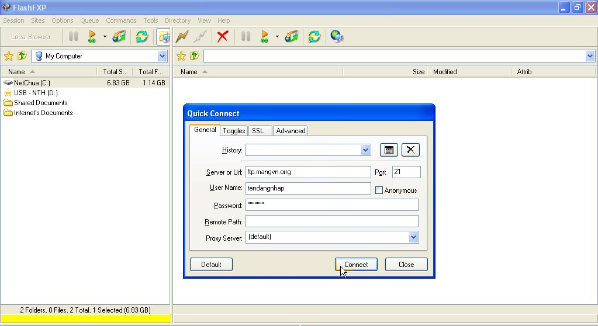
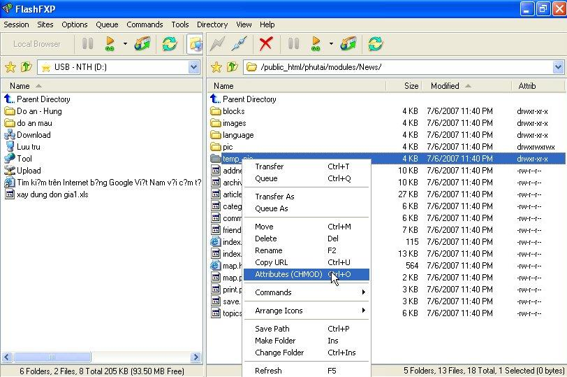
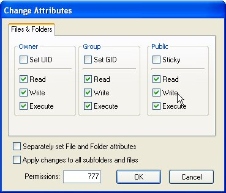
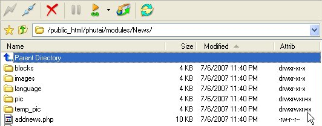

Tương tự LeapFTP & Windows Commander, Flash FXP có giao diện gồm 2 nửa:

- Nửa trái hiển thị các file và thư mục trên PC.

- Nửa phải hiển thị thư mục trên máy chủ.

\* Tạo kết nối tới máy chủ FTP:

- Bước 1: Chạy chương trình Flash FXP, nhấn vào biểu tượng **Quick Conect** để bật hộp thoại **Quick Conect**.

- Bước 2: Khai báo thông số kết nối và nhấp **Connect** để thực hiện kêt nối (xem hình 1)

\* Chmod file hoặc thư mục:

- Click chuột phải lên các file hoặc thư mục cần Chmod, chọn Attributes (xem hình 2)

- Hộp thoại Change Attributes bật lên, đánh dấu kiểm vào các ô, chế độ Chmod sẽ được ghi nhận tại ô Pemissions. khi chọn đúng chế độ chmod được yêu cầu, hãy nhấp OK. Tùy chọn Apply changes to all subfolders and files cho phép áp dụng thiết lập chmod cho tất cả các file & thư mục con trong thư mục được chọn.

- Chế độ chmod của từng file và thư mục được ghi dưới dạng ký hiệu bằng chữ ở cột **Attrib** (xem hình 4).

