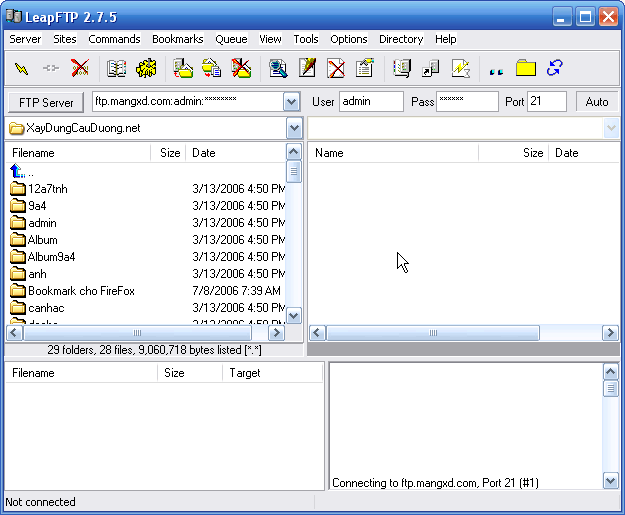

Cách sử dụng như sau

- Khởi động chương trình.

- Điền thông tin về FTP Server, User name và mật khẩu. Nhấn CTRL+Enter để thực hiện kết nối tới Server (xem hình 1).

- Giống như các trình FTP khác, cửa sổ chương trình có 2 phần. Khung bên trái là nội dung tập tin hoặc thư mục trên đĩa cứng máy của bạn. Bạn cần chỉ định thư mục chứa website trên đĩa cứng, nhắp phải chọn các thư mục hoặc tập tin (nếu muốn chọn nhiều thì nhấp & giữ phím Ctrl trong khi chọn thư mục hoặc file) và chọn upload. Lúc này các tập tin và thư mục sẽ được upload lên máy chủ web. Tiến trình upload tại thanh trạng thái phía dưới cửa sổ cho bạn biết quá trình upload diễn ra như thế nào.

- Khung bên phải là các file và thư mục trên server, nếu muốn xoá nội dung nào thì bạn cứ nhắp chuột phải vào đối tượng và chọn Delete. Để tải về file hoặc thư mục trên server bạn chọn Download.
