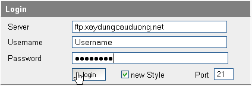
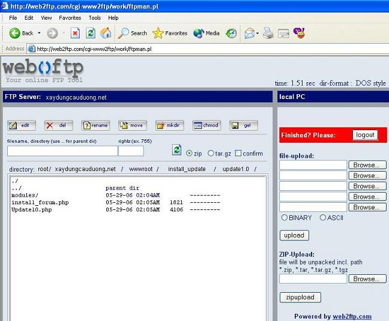
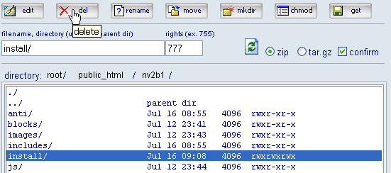
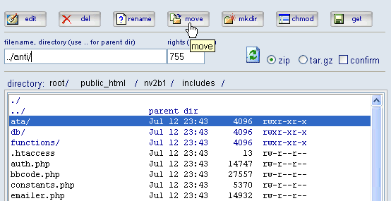
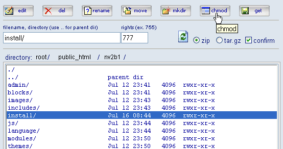
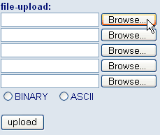
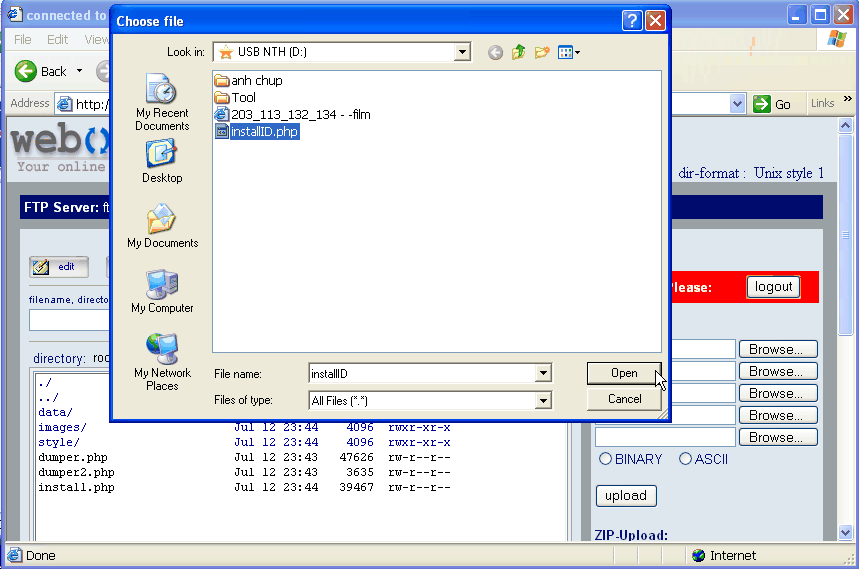
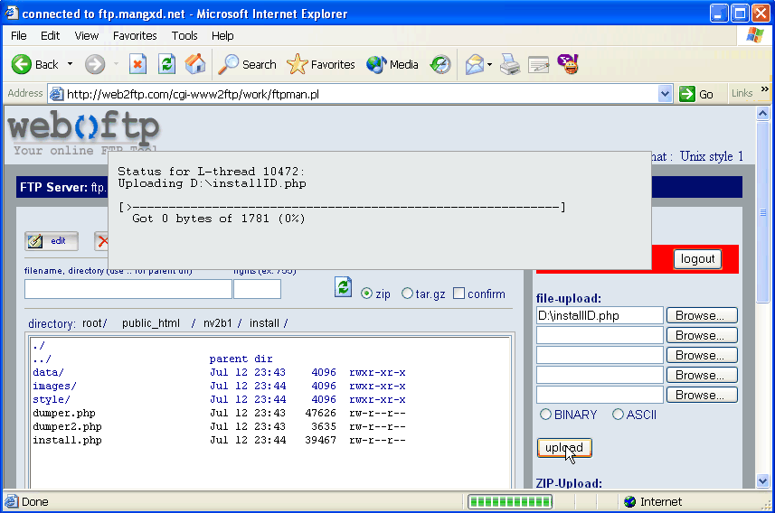
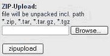

Web2ftp.com là một trang web cho phép kết nối vào Ftp với tốc độ tương đối cao. Bạn không mất công cài đặt như các phần mềm nên việc upload rất thuận tiện, có thể thực hiện mọi lúc, mọi nơi (tất nhiên là có kết nối vào Internet). Trình tự thực hiện kết nối như sau:

- Truy cập tới địa chỉ web2ftp.com và điền thông tin kết nối. Sau đó nhấp Login để kết nối tới host. (xem hình 1)



- Nếu kết nối thành công, bạn sẽ được đưa đến cửa sổ FTP với hai nửa. Nửa trái là FTP Server, hiển thị file và thư mục có trên Host của bạn. Nửa phải là Local PC, bạn chỉ định file cần tải từ PC (máy cá nhân) lên Sever (xem hình 2).



Website có hai hình thức Upload. Bạn có thể Upload cùng lúc 5 file thường (File-Upload) hoặc 1 file nén ZIP (Zip-Upload). Nếu dùng Zip-Upload để tải file nén Zip, File nén sau khi tải xong sẽ được tự động giải nén trên Server, rất thuận tiện trong trường hợp upload số lượng lớn các file nguồn như trường hợp của NukeViet. Cần chú ý giới hạn dung lượng file.

**Các thao tác cơ bản sử dụng trên Web2ftp:**

\* Thao tác trên Server

Sửa file: Cho phép sửa trực tiếp một số file php, html trực tuyến.

Xóa: Xóa file hoặc tư mục được lựa chọn. Để xóa, bạn hãy chọn một thư mục hoặc file trong danh sách, đánh dấu kiểm vào ô confirm, ấn del (xem hình 3)



Đổi tên: Để đổi tên, bạn hãy chọn một thư mục hoặc file trong danh sách, đánh dấu kiểm vào ô confirm, ấn Rename.

Di chuyển: Để di chuyển, bạn hãy chọn một thư mục hoặc file trong danh sách, gõ đường dẫn (tương đối so với thư mục hiện tại) cần di chuyển tới vào ô “filename, directory”, đánh dấu kiểm vào ô confirm, ấn Move (xem hình 4)



``` text
                                                (thư mục anti nằm trong thư mục nv2b1)
```

Tạo thư mục mới: Để tạo thư mục mới, bạn hãy gõ tên thư mục vào ô “filename, directory”, đánh dấu kiểm vào ô confirm, ấn mkdir.

Đổi thuộc tính: Để đổi thuộc tính, bạn hãy chọn một thư mục hoặc file trong danh sách, gõ chỉ số chmod vào ô rights, đánh dấu kiểm vào ô confirm, ấn chmod (xem hình 5).



Tải về: Để tải về một file hay thư mục, bạn hãy chọn một thư mục hoặc file trong danh sách, chọn định dạng nén là zip hay tar.gz, đánh dấu kiểm vào ô confirm, ấn Get.

\* Upload file từ PC lên server

- Từ menu File-Upload, nhấp nút Browse (xem hình 6).



- Hộp thoại choose file bật lên, bạn chọn file cần upload và nhấp nút Open (xem hình 7).



- File sẽ được đưa vào danh sách, tiếp tục tìm đến các file còn lại (upload tối đa 5 file một lần). Nhấp nút upload để bắt đầu tải file lên. Tiến trình tải sẽ được thể hiện ngay trên cửa sổ (xem hình 8). Chờ cho tiến trình kết thúc bạn có thể tiếp tục upload các file còn lại.



\* Zip-upload từ PC lên server

- Zip-Upload là một tính năng vô cùng tiện lợi khi cần upload nhiều file với dung lượng nhỏ, ví dụ như khi upload bộ cài NukeViet. Sử dụng tính năng này để upload các file nén zip, sau khi upload, các file sẽ được giải nén ngay trên server. Vì đã được nén trước khi upload nên phương pháp này có nhiều ưu điểm như tốc độ upload nhanh, tiết kiệm băng thông, tiết kiệm thời gian …

- Thao tác hoàn toàn tương tự như upload file, chỉ có điều bạn sẽ sử dụng menu zip-upload (xem hình 9)



- Điểm khác biệt duy nhất ở đây là sau khi tiến trình Upload file kết thúc (đạt 100%), bạn sẽ thấy tiến trình send file từ máy chủ Web2ftp đến máy chủ FTP của bạn. Bây giờ bạn có thể tắt hoàn toàn cửa sổ Internet Explorer mà không sợ ảnh hưởng đến tiến trình này.

**Gợi ý:**

- Để tăng tốc độ upload, với các file dung lượng nhỏ ta nên sử dụng Zip-Upload.

- Khi tiến trình send file từ máy chủ Web2ftp đến máy chủ FTP bắt đầu (tiến trình Upload file đã đạt 100%) bạn có thể tận dụng thời gian này bằng cách tiếp tục zip-upload các file khác.

**Lưu ý:**

- Nếu sử dụng tính năng zip-upload, bạn phải chờ tiến trình send file từ máy chủ Web2ftp đến máy chủ FTP kết thúc thì mới có thể tiến hành cài đặt NukeViet (vì khi đó các file mới được gửi đến đầy đủ trên Server). Quá trình này mất khoảng 10-30 phút (đối với bộ cài NukeViet 1.0).

- Sau khi làm việc xong, nhớ chọn **Logout** hoặc tắt hoàn toàn Internet Explorer để thoát khỏi web2ftp.
