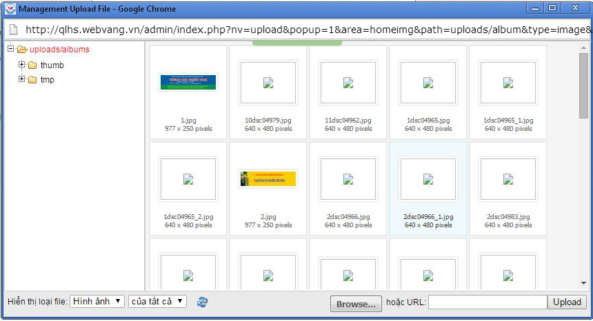
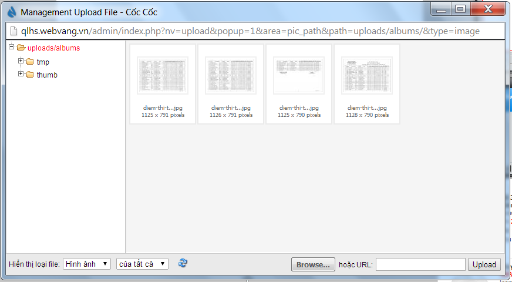
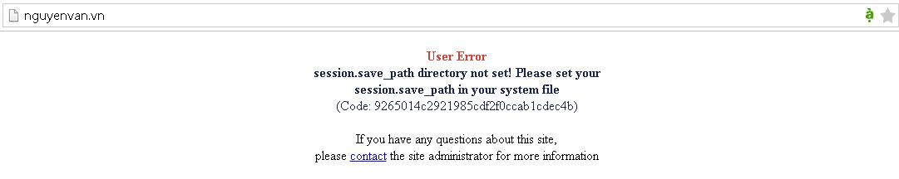

Nếu mua hosting Linux, bạn cần quan tâm đến chế độ Chmod. Vậy Chmod là gì?

Chmod là xác lập quyền hạn của người truy cập đối với 1 file trên Server. Nó giống như Thuộc tính (Properties) trong Windows.

Trên các hệ thống Unix/linux, người sử dụng được chia ra làm 3 nhóm: "user" hay “owner” (chúng ta - chủ nhân trực tiếp của các files), "group" (thành viên của nhóm mà người chủ nhân file có tham gia) và "world" hay “Public” (tất cả những trường hợp khác - công cộng). Khi bạn kết nối với server, nó sẽ xác định xem bạn thuộc về nhóm nào. Ví dụ bạn kết nối với server bằng FTP, khai báo tên truy cập như một thành viên và truy cập tới các file của bạn, server sẽ quy bạn vào nhóm "user". Còn những thành viên khác truy cập bằng FTP thuộc về nhóm "group". Khi ai đó đến site của bạn bằng trình duyệt web, sẽ được quy vào nhóm "world".

Sau khi xác định nhóm, người sử dụng sẽ được gán quyền hạn nhất định đối với file hoặc thư mục nào đó.

- Để xác định quyền hạn cho các nhóm nhất định, người ta sử dụng các ký hiệu bằng con số như sau:

``` text
4 = read (quyền được đọc)
2 = write (quyền được ghi)
1 = execute (quyền được thực hiện)
```

- Các con số này tổ hợp ra 7 phương án:

``` text
7 = read, write & execute
6 = read & write
5 = read & execute
4 = read
3 = write & execute
2 = write
1 = execute
```

- Ký hiệu lệnh Chmod thường có 3 con số: con số đầu thể hiện quyền hạn gán cho người sử dụng thuộc nhóm "user" (chính là bạn). Con số thứ hai chỉ ra quyền hạn của người sử dụng thuộc nhóm "group" và con số thứ ba dành cho nhóm "world".

- Trong trường hợp sử dụng ký hiệu chữ, chúng ta sẽ bắt gặp những ký hiệu sau:

``` text
"r" - quyền được đọc
"w" - quyền được ghi
"x" - quyền được thực hiện
```

- Ngoài ra còn có:

``` text
"u" - đối với user
"g" - đối với group
"o" - đối với other (world)
"a" - đối với all (tất cả)
```

- Dưới đây là bảng các tổ hợp thường gặp:

| Quyền truy cập |  |  | Lệnh (Mã) | Miêu tả |
|:---|----|----|----|:---|
| U | G | W |  |  |
| r w x | r - x | r - x | chmod 755 | Dành cho các thư mục, CGI-scripts và những files thực hiện khác |
| r w - | r - - | r - - | chmod 644 | Dành cho các files thường |
| r w - | \- - - | \- - - | chmod 600 | Giấu files đối với tất cả ngoại trừ bạn và những scripts của bạn |
| U = user; G = group; W = world r = Read; w = Write; x = Execute; - = Không có quyền |  |  |  |  |

# Cmod 777 một số thư mục cần thiết

- /data và các thư mục con của data
- /cache
- /files
- /files và các thư mục con
- /language và các thư mục con
- /modules
- /logs và các thư mục con bên trong nó
- /sess
- /themes
- /themes/../modules
- /upload và các thư mục bên trong

# Một số lỗi thường gặp về cmod trên hosting Linux

## 1) Lỗi khong nhìn thấy file thump sau khi upload và cmod các thư mục cần thiết.



Cách fix lỗi này như sau:

B1: Cmod thư mục Files/dcache thành 777.

B2: Xóa tất cả file trong thu mục Files/dcache.

B3: Đăng nhập admin của site.

B4: Vào Menu "Công cụ web" \> "Dọn dẹp hệ thống".

B5: Nhấn chọn all.

B6: Và nhấn thực hiện.

B7: Vào lại các module xem hình ảnh thump đã hiện thị.

Kết quả :



## 2) User Error: session.save_path directory not set!



Nguyên nhân : Thư mục sess chưa được sét quyền write cho thư mục

Fix User Error: session.save_path directory not set:

- Set cmod thư mục sess thành 777
