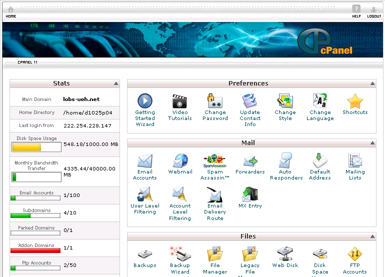

**Khái niệm về cPanel**

Đối với những Webmaster của một website bất kỳ phải dùng những công cụ của nhà cung cấp host để quản lý website của mình như: thêm domain, upload file, quản lý cơ sở dữ liệu, làm mail server...., những công cụ đó gọi là Web Host Manager (WHM) cPanel là một trong những WHM tốt, dễ sử dụng và có rất nhiều tính năng tiện dụng. Phiên bản mới nhất của cPanel là cPanel 11.

Các tính năng chủ yếu:

- Quản lý Cơ sở dữ liệu MySQL trên máy chủ

- File Manager

- FTP Account

- Password Protected Directories

- Quản lý Domain (tên miền)

- Quản lý Mail Server

-  Và một số tính năng khác...

**Ghi chú:**

Không phải nhà cung cấp host nào cũng cài sẵn cPanel trên máy chủ, khi đó ta phải sử dụng công cụ mà máy chủ đang sử dụng.

Ngoài cPanel còn một số WHM khác như [DirectAdmin](http://www.derectadmin.com), [Plesk](http://www.swsoft.com/plesk), [Kloxo](http://lxcenter.org/software/kloxo/) (trước đây được biết đến với tên gọi Lxadmin) ....

## Các bài viết liên quan

1.  [Quản lý cơ sở dữ liệu MySQL trên máy chủ](/support/hosting/cpanel/mysql)
2.  [File manager (của Cpanel)](/support/hosting/cpanel/file_manager)
3.  [FTP Account](/support/hosting/cpanel/ftp)
4.  [Addon domains, Sub domains, Parked domains](/support/hosting/cpanel/domain)
5.  [Cài đặt SSL](/support/hosting/cpanel/ssl)
