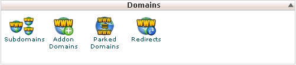
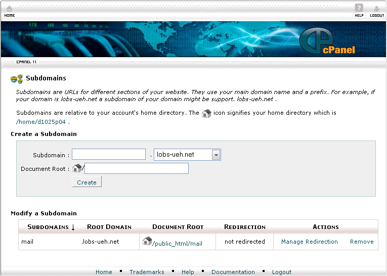
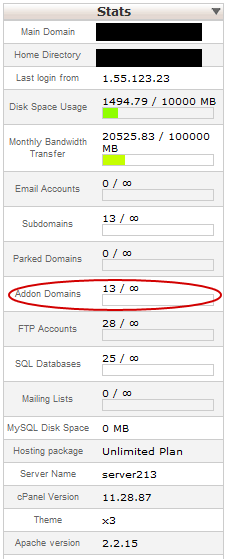
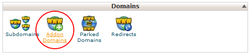
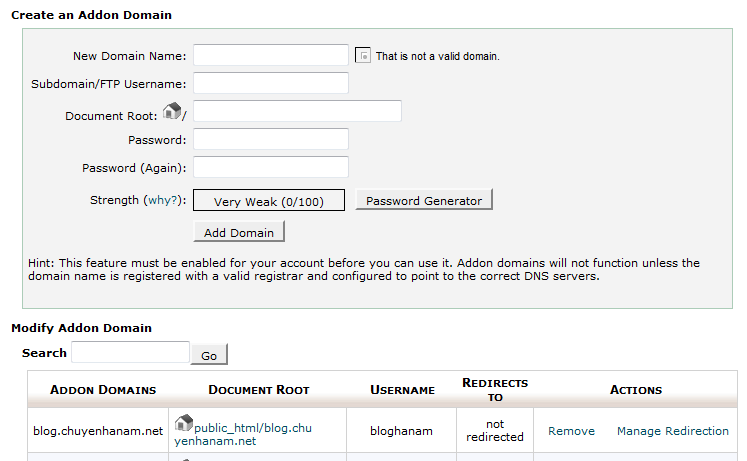
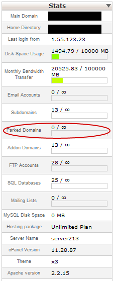
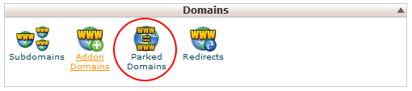
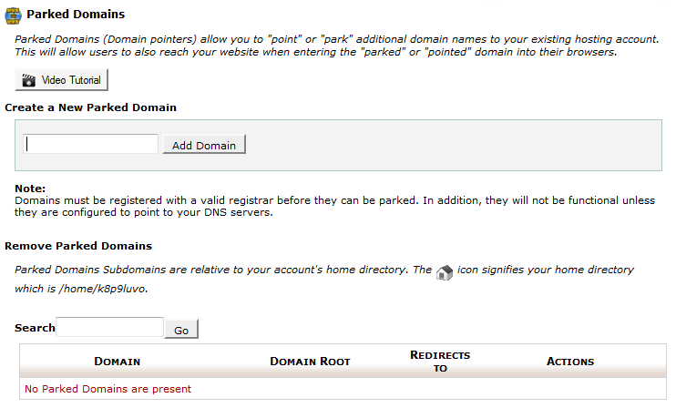

Tên miền là gì? Là địa chỉ của một website dưới dạng một chuỗi chữ có ý nghĩa gợi nhớ giúp người sử dụng dễ dàng tìm đến website bằng cách gõ tên miền vào ô địa chỉ truy cập (Address bar) của trình duyệt (địa chỉ thật của 1 website là một chuỗi dãy số IP khó nhớ).

VD: domain: www.vnn.vn có địa chỉ IP là: 203.162.168.130

Từ tên miền này, chúng ta có những thành phần phụ phía sau gọi là URL dẫn đến những phần khác nhau trong web của chúng ta, ví dụ: [http://vietnamnet.vn/xahoi/2007/07/712623/](http://vietnamnet.vn/xahoi/2007/07/712623/)

Khi mới mua host và mua tên miền, nhà cung cấp thường gắn sẵn tên miền cho chúng ta vào host đã mua, tuy nhiên nếu mua riêng lẽ host hoặc chúng ta muốn bổ sung thêm một tên miền khác trỏ vào host thì phải đụng đến tín năng quản lý domain – tên miền.

Chức năng quản lý domain xuất hiện ngay trên trang chủ của cPanel, chức năng quản lý domain cung cấp những tính năng sau:

### Subdomains: Thêm tên miền cấp con cho 1 tên miền có sẵn

- Tên miền cấp con là một tên miền dùng tên miền chính cộng với 1 từ khóa nào đó, từ khóa này được thêm vào phía trước tên miền chính hoặc 1 tên miền cấp con khác, phân cách bởi dấu chấm.

Ví dụ: tên miền chính là [http://yahoo.com](http://yahoo.com) thì có thể có tên miền con là [http://mail.yahoo.com](http://mail.yahoo.com)

- Số tên miền cấp con bị giới hạn bởi nhà cung cấp, thông thường là 10 tên miền cấp con các loại cho 1 tên miền chính. Chúng ta có thể xem thông tin này ở panel Stat (Statistic – Thống kê) bên trái trên trang chủ của cPanel.

**Cách tạo/chỉnh sửa Subdomain**

Di chuyển đến phần quản lý Domain, nhấn vào Subdomains (Hình 1)

Khi đó, cPanel sẽ trả về form thông tin subdomain như (Hình 2)

Tại đây, chúng ta nhập từ khóa tạo tên miền cấp con vào ô Subdomain.

Khi đó, cPanel sẽ tự điền giá trị vào ô Document Root (thư mục chứa các file hiển thị khi người sử dụng truy cập đến tên miền cấp con này). Thông thường cPanel sẽ lấy từ khóa mà ta nhập ở trên để tạo một thư mục mới trong thư mục gốc trên máy chủ, chúng ta có thể chỉnh lại thông tin thư mục này nếu đã chuẩn bị các file cho tên miền cấp con trong 1 thư mục đã có trên máy chủ.

Nhấn Create để tạo Subdomain. Tên miền cấp con có thể sử dụng ngay lập tức sau khi tạo.

Phía dưới khung tạo Subdomain là những tên miền và tên miền cấp con đã tạo trước đó, chúng ta có thể thay đổi (Manage Redirection) thư mục gốc (Document Root) của 1 tên miền đã tạo, hay xóa hẳn (Remove) tên miền cấp con đã tạo

**Ghi chú**:

Chức năng Quản lý tên miền cấp con (Manage Redirection) 0 có thể giúp ta chuyển hướng tên miền cấp con chỉ đến 1 địa chỉ (URL) website bất kỳ trên mạng. Khi đó khi nhập tên miền cấp con này, người sử dụng sẽ được chuyển đến website đã chỉ định, trên thanh địa chỉ của trình duyệt (Address bar) sẽ hiển thị URL của website đó.

### Addons domain

Addon domain là tính năng cho phép gán các tên miền khác nhau vào các subdomain của tên miền chính của hosting đó. Ví dụ: Hosting cho phép bạn có thể addon domain, bạn có 2 domain domain1.com và domain2.com, domain1.com được gán vào hosting có hỗ trợ addon domain, bây giờ bạn muốn chạy 02 website khác nhau trên cùng 1 hosting có địa chỉ là domain1.com thì chúng ta cần sử dụng chức năng này.

Để sử dụng được addon domain chúng ta cần phải chắc chắn hosting của mình cho phép có thể thêm bao nhiêu domain bằng cách quan sát hình dưới đây:

Để bắt đầu sử dụng chức năng addon domain chúng ta cần qua các bước sau:

Tìm group **Domains**, tiếp đến tìm đến menu Addon domains như hình sau:

Sau khi vào menu Addon Domains sẽ hiển thị ra bảng để thêm 1 addon domain mới:

**Chú ý:**

- Ô New Domain Name: Điền domain bạn muốn thêm vào hosting

- Ô Subdomain/FTP Username: Cpanel 11 sẽ tự tạo ra cho bạn, nếu muốn sửa các bạn có thể chỉnh sửa lại thông tin.

- Ô Document Root: Tương tự như Subdomain/FTP Username

- Password và Password (Again): Nhập vào password của tài khoản FTP, bạn có thể tự nhập hoặc sử dụng chức năng Password Generator của cPanel 11 để dùng.

- Ô Strength: Đánh giá độ mạnh của password nhập vào (trường hợp tự điền password) – các bạn căn cứ vào độ mạnh của password được cPanel đánh giá để đưa ra mật khẩu thích hợp đề phòng trường hợp xấu có thể xảy ra.

- Sau khi thêm mới một addon domain thì sẽ được list ở phía dưới dòng Modify Addon Domain, ở đó các bạn có chỉ có 2 chức năng: Gỡ bỏ (Remove) Addon Domain hoặc Chuyển hướng Addon Domain (Manage Rediretion)

### Parket domain

Parket domain là dạng domain chạy song song, nói nôm la 1 hosting cho phép chạy 1 website cùng nội dung trên nhiều domain. Giống như Addon Domains, để có thể sử dụng được thì bạn phải chắc chắn rằng không vượt quá giới hạn parket domain của hosting bằng cách quan sát trạng thái parket domains như hình dưới đây:

Để sử dụng chức năng **Parket Domains** chúng ta cần qua các bước sau:

- Tìm đến **group Domains**, tiếp đến tìm menu **Parket Domains**(Hình 7)

- Sau chọn menu **Parket Domains** sẽ ra bảng để thêm 1 domain mới vào host như hình sau:

**Chú ý:**

- Để thêm một parket domain mới ta cần điền tên domain vào ô Create a New Parked Domainsau đó nhấn vào nút “Add Domain”

- Để gỡ bỏ một Parket Domainchúng ta nhìn vào bảng Remove Parked Domains, tìm domain cần gỡ bỏ, nhìn sang cột Actions và chọn “Remove”.

**Chú ý chung**: Khi sử dụng chức năng Addon Domains và Parked Domainscác bạn phải chuyển DNS của domain về đúng địa chỉ DNS của nhà cung cấp hosting.
