Ở phiên bản cPanel 10, File Manager đã rất tuyệt vời có tính năng unzip, CHMOD nhiều file ... và rất dễ sử dụng. Đến phiên bản cPanel 11 này, giao diện đẹp hơn, chuyên nghiệp hơn chứ không đơn giản như File Manager của cPanel 10 và có đến 2 phiên bản File Manager cho chúng ta lựa chọn.

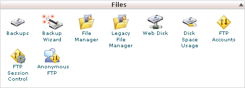

Thể hiện các công cụ quản lý File. Giả sử chúng ta mới mua host, trên máy chủ đang trống rỗng thì việc chúng ta quan tâm đầu tiên đến việc upload file lên máy chủ.

Có 3 cách chính để thực hiện điều này:

a\) Dùng 1 chương trình FTP nào đó kết nối vào tài khoản FTP để upload, xóa, download, ... các file trên máy chủ.

b\) Dùng chương trình File Manager của WHM có sẵn.

c\) Lai tạp

\* Với cách a), chúng ta có thể dùng các chương trình FTP client truyền thống như LeapFTP, FTP Explorer, CuteFTP,... hoặc các chương trình tích hợp chức năng FTP như Total Commander, FireFox FTP addon ...

**Ưu:** cách dùng những chương trình FTP truyền thống rất an toàn khi upload những file có dung lượng lớn. Có nhiều tài khoản FTP khác nhau để truy cập với quyền hạn nhất định vào từng thư mục của máy chủ. Có chức năng đồng bộ hóa dữ liệu (so sách sự khác biệt giữa các thư mục, file trên máy chủ và máy cục bộ từ đó chọn những file có sự thay đổi để upload hoặc download).

**Nhược:** các dòng lệnh được gửi từ máy khách lên máy chủ nên đôi lúc thực hiện bị chậm, trì hoãn, thỉnh thoảng đứng giữa chừng khi truyền nhiều file... không tận dụng cách chức năng mà máy chủ sẵn có, chỉ có thể có 1 đến 3 kết nối nối vào 1 tài khoản FTP vào cùng 1 thời điểm.

\* Với cách b), chương trình chạy trực tiếp trên máy chủ, giao tiếp với người sử dụng bằng giao diện Web.

**Ưu:** vì các mã lệnh được xử lý trực tiếp trên máy chủ nên rất nhanh và đảm bảo được thực hiện. Tận dụng được ưu điểm của các lệnh, hàm của máy chủ để xử lý lệnh (zip, unzip...)

**Nhược:** không phải WHM nào cũng cung cấp File Manager đủ mạnh và làm hài lòng người sử dụng. Không chia quyền quản trị File Manager được vì chỉ có Admin người đặt mua host mới có quyền vào File Manager cũng như nhiều thành phần quan trọng khác của WHM. Giới hạn không upload các file lớn được (do giới hạn của host nhận file qua giao thức http).

\* Với cách c)cách lai tạp giữa 2 cách trên là dùng 1 chương trình tự cài lên máy chủ, có tính năng quản lý FTP qua giao diện Web (giao thức http), tiêu biểu là Net2Ftp.com

\*\*Ưu: \*\* Vì là mã lệnh chạy trực tiếp trên máy chủ nên tận dụng được các tính năng chỉ có máy chủ mới có (zip, unzip...) đồng thời có thể chia quyền quản trị vì tuy là giao diện web nhưng nối vào tài khoản ftp (dùng giao thức http quản lý giao thức ftp). Dùng thay thế File Manager của máy chủ khi nó không đáp ứng nhu cầu của người sử dụng.

**Nhược:** vì là chương trình người dùng tự đưa vào máy chủ nên vẫn có hạn chế về thời gian xử lý mã lệnh, kích thước file truyền lên, giới hạn băng thông của tài khoản FTP.

Tùy từng trường hợp cụ thể ta có thể dùng kết hợp các cách trên để quản lý file trên máy chủ.

Trở lại với cPanel, để thực hiện cách a), chúng ta phải tạo các tài khoản FTP để kết nối lên máy chủ.

### Tạo một tài khoản FTP

Nhấn vào công cụ FTP Account tại phần quản lý File của cPanel (Xem Hình 2)

Giao diện quản lý các tài khoản FTP xuất hiện như Hình 2

Tại đây, chúng ta nhập tên tài khoản vào ô login, mật mã tương ứng vào ô Password và Password again (thanh Password Strength hiển thị mức độ bảo mật của password, chỉ mang tính tham khảo)

Nhập tên thư mục chỉ định tài khoản này được phép quản lý vào ô Directory. Lưu ý tài khoản này được quản lý thư mục được chỉ ra ở đây và các thư mục cấp con của nó. Thư mục cấp cha sẽ không bị ảnh hưởng.

Nhập hạn mức upload cho tài khoản FTP này vào ô Quota (chính là dung lượng tối đa của thư mục này khi tài khoản FTP này kết nối – tài khoản FTP khác thể có hạn mức khác đối với cùng thư mục).

Nhấn Create để kết thúc tạo tài khoản FTP mới.

Ghi chú:

Nếu thông tin chính xác và không bị lỗi, tài khoản ftp mới tạo sẽ sử dụng được ngay lập tức.

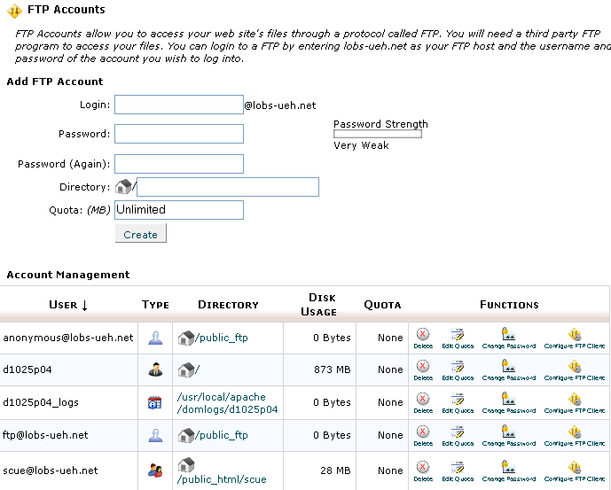

### Chỉnh sửa thông tin của một tài khoản FTP

Nhấn vào công cụ FTP Account tại phần quản lý File của cPanel (Xem Hình 3)

Giao diện quản lý các tài khoản FTP xuất hiện như Hình 3.

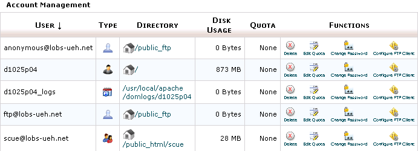

Tên của các tài khoản FTP xuất hiện bên trái, các nút lệnh quản lý tương ứng bên phải gồm:  
Delete: Xóa tài khoản FTP tương ứng

  
Edit Quota: Thay đổi hạn mức upload của tài khoản FTP tương ứng

  
Change Password: Đổi mật mã cho tài khoản FTP tương ứng

  
Configure FTP Client : gồm các file cấu hình sẵn cho những chương trình FTP client thông dụng và thông tin kết nối của tài khoản FTP tương ứng nếu muốn tự cấu hình FTP client bằng tay.

**Ghi chú:**

Ta không thể thay đổi thư mục được quản lý của 1 tài khoản FTP đã tạo, muốn thay đổi ta phải xóa đi và tạo lại tài khoản FTP đó.

Configure FTP Client chứa những thông tin quan trọng giúp kết nối vào tài khoản FTP như tên ftp host, user, password, cổng kết nối ftp ...

Phía dưới giao diện quản trị FTP, còn có 1 phần là log FTP theo dõi những phiên làm việc của tất cả các tài khoản FTP.

### Các công cụ quản lý FTP khác

Vào bất kỳ thời điểm nào, bạn có thể biết được tài khoản FTP nào đang kết nối vào máy chủ, và từ đó có thể cưỡng chế ngắt kết nối FTP này bằng công cụ theo dõi phiên làm việc FTP Section Control tại Khu vực quản lý File của cPanel 11 (Hình 4).

Quản lý tài khoản FTP nặc danh, bạn có thể cho những người nặc danh truy cập vào tài khoản FTP của bạn, cách quản lý:

Nhấn vào công cụ Anonymous Account tại Khu vực quản lý File của cPanel (Hình 4)

Giao diện quản lý các tài khoản FTP nặc danh xuất hiện

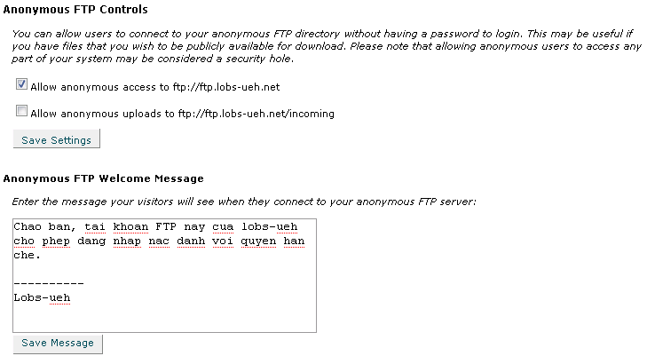

Nếu đồng ý cho người khác sử dụng tài khoản nặc danh, check vào các ô allow tương ứng. Nếu cho phép người dùng truy cập tài khoản FTP nặc danh, tài khoản này sẽ có user và là anonymous, pass là email của người đăng nhập.

Vùng Message dùng để chứa thông báo cho người truy cập nặc danh khi sử dụng tài khoản này.

### Công cụ quản lý tập tin File Manager của cPanel

Đây là cách b) như đã nêu ở trên, File Manager của cPanel 11 có 2 phiên bản là 2.0 và 3.0. Cả 2 đều có những tính năng riêng nên không thể nói phiên bản nào tốt hơn.

### Cách thức vào File Manager 2.0:

Tại Khu vực quản lý File của cPanel 11 (Hình 5), nhấn chuột vào liên kết Legacy File Manager, hộp thoại chọn thư mục quản trị xuất hiện như 0 (nếu đã từng check vào ô Skip this question, and always open this directory in the future when opening File Manager thì hộp thoại này không xuất hiện)

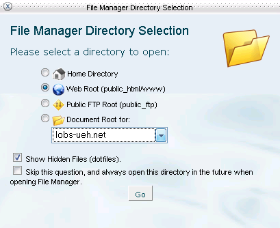

Ở đây ta nên chọn Webroot để đến thư mục gốc trên máy chủ.

Nhấn Ok để xác nhận, nhấn dấu chéo bên góc trái phía trên hộp thoại để hủy lệnh.

Sau khi xác nhận thư mục quản lý, File Manager 2.0 sẽ xuất hiện (Hình 6)

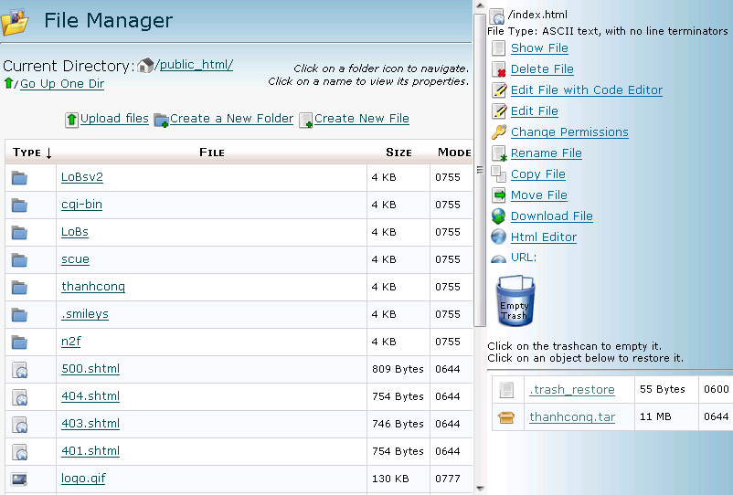

File Manager 2.0 có đầy đủ những tính năng tối thiểu của việc quản lý file và thư mục.

Phía trên là những liên kết giúp định vị thư mục đang quản lý, di chuyển nhanh về thư mục cấp cha ... các lệnh cơ bản upload, tạo file mới, tạo thư mục mới ...

Bên trái là danh sách liệt kê các thư mục và tập tin trong thư mục hiện hành. Nhấn vào tên hoặc biểu tượng ở đầu dòng để chọn đối tượng, khi một đối tượng được chọn thì những lệnh tương ứng với đối tượng đó xuất hiện bên khung bên phải bao gồm upload, download, đổi tên, sao chép, di chuyển, xóa, chỉnh sửa nội dung hoặc chỉnh code của file, thay quyền truy cập file hay thư mục – CHMOD, ....

Các thao tác quản lý tập tin trên File Manager 2.0 rất đơn giản, trực quan, một người đã quen với việc thao tác sao chép, di chuyển đổi tên tập tin và thư mục trên Windows không

Phía dưới bên phải là thùng rác, dùng để chứa những gì mà chúng ta xóa.

File Manager 2.0 có 1 tính năng rất hay mà các chương trình FTP clinet truyền thống không có là giải nén 1 file nén dạng zip, gz, tar, ... Khi ta chọn 1 tập tin dạng nén ở bên trái, sẽ có lệnh Extract File Content ở khung bên phải. Nhấn vào nút lệnh này toàn bộ nội dung trong file nén sẽ được bung ra tại thư mục chứa file nén.

Kết quả, File Manager 2.0 sẽ báo cáo chi tiết bằng 1 hộp thông báo

Ghi chú:

Riêng các thư mục, nhấn vào biểu tượng của nó nghĩa là mở thư mục đó để vào thư mục cấp con. Việc phân biệt chọn và mở thư mục này quan trọng trong việc chọn đúng thư mục đích khi copy, di chuyển các đối tượng trong File Manager 2.0.

File Manager 2.0 chỉ cho phép chọn 1 đối tượng để quản lý trong 1 thời điểm.

Để tận dụng tính năng giải nén của File Manager, tốt nhất là dùng các chương trình FTP Client truyền thống upload các file dung lượng lớn lên máy chủ rồi ra lệnh giải nén. Việc này tiết kiệm thời gian upload và thuận tiện hơn nhiều so với việc upload từng file bằng FTP Client.

Thao tác giải nén sẽ ghi đè lên những tập tin đã tồn tại trên máy chủ nếu trùng tên.

Thuộc tính của các thư mục và file sau khi giải nén có thể không được khôi phục như lúc trước khi nén, có nghĩa là phải CHMOD lại nếu cần thiết.

Khi giới hạn Disk Space của máy chủ hết, có thể file nén sẽ không giải nén hết được, khi đó sẽ có thông báo trong hộp thông báo

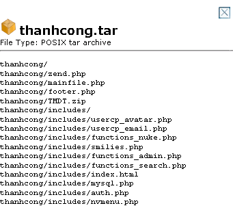

File Manager còn có 1 tính năng độc đáo mà File Manager 3.0 không có, đó là tính năng thùng rác. Khi ta xóa bất kỳ đối tượng nào bằng File Manager 2.0, những đối tượng này sẽ được di chuyển đến Trash (thùng rác) phía bên phải. Và ta có thể xóa hẳn (đổ rác) hoặc khôi phục dữ liệu từ thùng rác này (Hình 8).

Nhấn vào thùng rác để đổ rác (xóa thật sự tất cả đối tượng trong thùng rác khỏi máy chủ)

Nhấn vào một đối tượng bất kỳ trong thùng rác để khôi phục nó về đúng vị trí trước khi xóa.

\*\* Ghi chú: \*\*

Dung lượng của thùng rác vẫn được tính vào tổng dung lượng các file trên máy chủ, do đó hãy đổ rác nếu cần thêm không gian lưu trữ.

Thùng rác không có tính năng xóa 1 đối tượng trong thùng rác, khi đổ rác là xóa toàn bộ đối tượng đang có trong thùng rác.

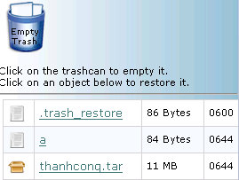

Sau đây, chúng ta xem qua phần File Manager 3.0 của cPanel 11

### Cách thức vào File Manager 3.0:

Tại Khu vực quản lý File của cPanel 11 (Hình 9), nhấn chuột vào liên kết File Manager, hộp thoại chọn thư mục quản trị xuất hiện như 0 (nếu đã từng check vào ô **Skip this question, and always open this directory in the future when opening File Manager** thì hộp thoại này không xuất hiện

Ở đây ta nên chọn Webroot để đến thư mục gốc trên máy chủ.

Nhấn Ok để xác nhận, nhấn dấu chéo bên góc trái phía trên hộp thoại để hủy lệnh.

Sau khi chọn thư mục quản lý, giao diện File Manager 3.0 xuất hiện như Hình 10:

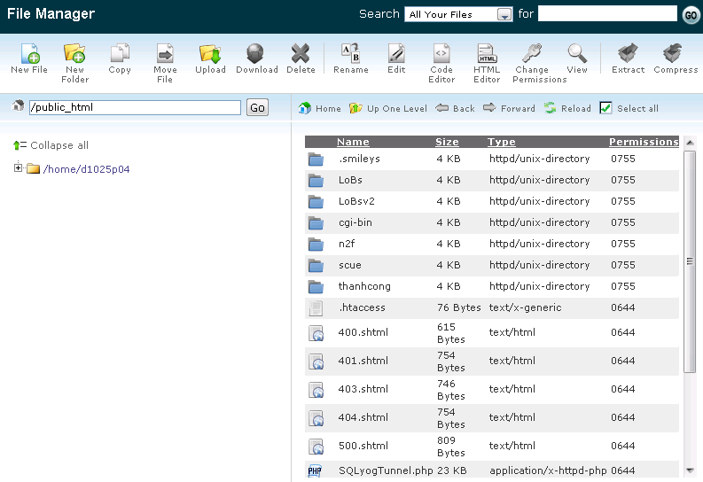

Giao diện của File Manager 3.0 giống y hệt giao diện của Windows Explorer với cây thư mục bên trái, nội dung thư mục hiện hành bên phải, các lệnh tương ứng tác động lên thư mục đang chọn liệt kê ở phía trên, tùy vào đối tượng đang chọn mà những nút lệnh này có hiệu lực hoặc vô hiệu (sáng lên hay mờ đi)

\* File Manager 3.0 thuận tiện hơn rất nhiều so với bản File Manager 2.0 ở chỗ:

- Có thể chọn đồng thời nhiều đối tượng và ra lệnh tác động cho nhóm đối tượng này (Hình 11).

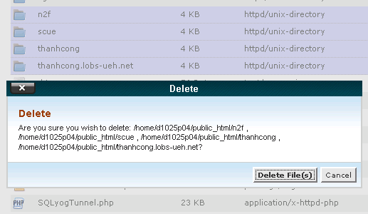

- Các nút lệnh thiết kế phía trên và tác động trực tiếp lên đối tượng đang chọn (file, thư mục)

- Đổi tên 1 đối tượng, hoặc đổi quyền truy cập đối tượng (CHMOD) dễ dàng bằng cách nhấn chuột vào ô tương ứng của đối tượng và gõ tên mới hoặc mã CHMOD vào ô nhập liệu (Hình 12).

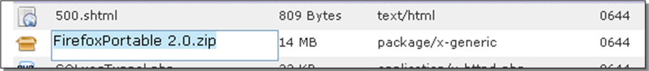

- Có thêm chức năng nén từng thư mục hoặc nén các đối tượng đang chọn bằng nút lệnh Compress, tương tự có chức năng giải nén bằng nút lệnh Extract.
- Có thêm tính năng tìm kiếm trên máy chủ: nhập điều kiện tìm kiếm vào ô Search for ở đầu trang và nhấn Go, File Manager sẽ tìm trên host và trả kết quả về như **Error! Reference source not found.**

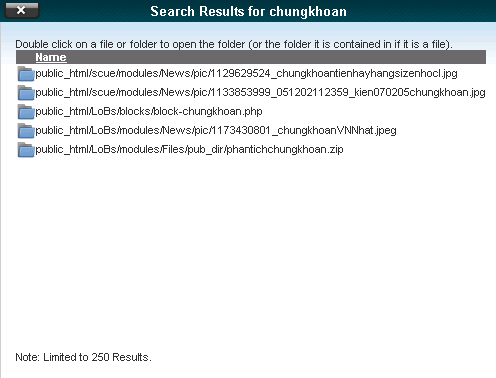

Bên cạnh đó, File Manager 3.0 cũng có hạn chế là không có thùng rác như File Manager 2.0. Bù lại File Manager 3.0 yêu cầu chúng ta xác nhận mỗi khi xóa 1 đối tượng nào đó .

**Ghi chú:**

- Tính năng Nén (Compress) của File Manager sẽ không thực hiện được khi không gian lưu trữ (disk space) của host không đủ.

- Tính năng Giải nén (Extract) của File Manager 3.0 giống phiên bản 2.0

- Tính năng tìm kiếm chỉ hiển thị tối đa 250 kết quả tìm thấy, và chỉ cung cấp địa chỉ của những đối tượng tìm được chứ không cho phép di chuyển nhanh đến đối tượng và không cho phép thao tác (sao chép, xóa, di chuyển ...) trực tiếp từ khung kết quả tìm kiếm
