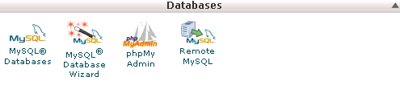
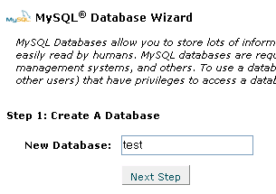
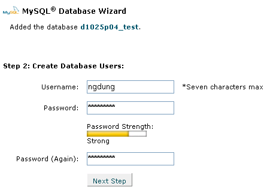
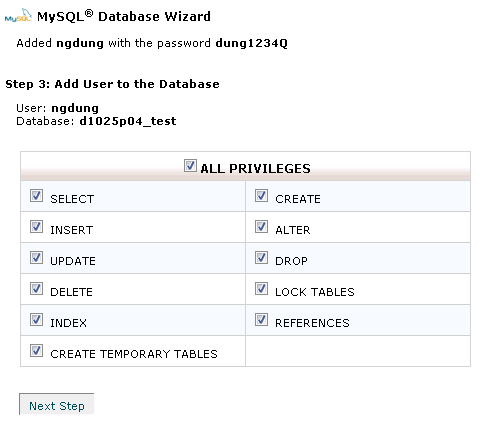
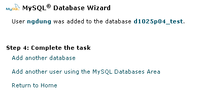
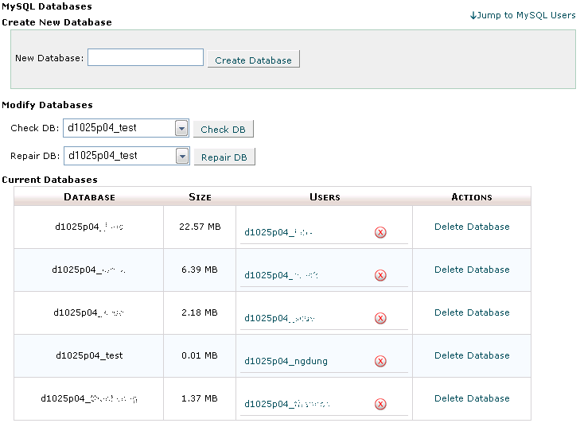
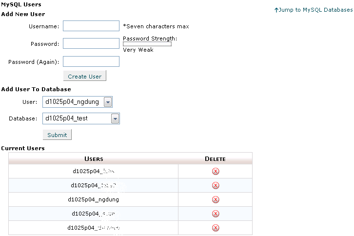

Cơ sở dữ liệu MySQL được sử dụng phổ biến ở những máy chủ cài PHP, hệ thống NukeViet sử dụng cơ sở dữ liệu MySQL để lưu các thông tin.

Mỗi cơ sở dữ liệu có thể có nhiều hơn 1 user gắn vào quản trị với những quyền hạn khác nhau. Việc này rất quan trọng trong việc bảo mật thông tin, và nhất là giúp vượt qua hạn chế quota của từng user trên máy chủ (xem thêm phần cấu hình NukeViet để tự động thay đổi user log vào cơ sở dữ liệu theo thời gian trong ngày nhằm hạn chế tần suất truy cập cơ sở dữ liệu của host tính trên 1 user).

### Tạo 1 cơ sở dữ liệu mới bằng Wizard

Tạo 1 cơ sở dữ liệu rất đơn giản, ở bản cPanel 11 này, ta không thể tạo mới 1 cơ sở dữ liệu trong phpMyAdmin, vì vậy ta dùng 1 công cụ mới của cPanel mà phiên bản cũ không có, đó là MySQL Database Wizard trong khu vực Quản lý cơ sở dữ liệu MySQL

Nhấn vào công cụ MySQL Database Wizard, màn hình xuất hiện như hình dưới

Tại đây, ta nhập tên cơ sở dữ liệu mới vào hộp thoại và nhấn Next step

Tiếp đó, Wizard yêu cầu chúng ta nhập thông tin user tương ứng của cơ sở dữ liệu này.

Nhấn Next Step để tiếp tục

Chú ý: lúc này cơ sở dữ liệu đã được tạo với tên mãngườidùnghost_têncsdl, trong hình minh họa (Hình 3) là d1025p04_test

Tiếp theo Wizard yêu cầu ta gán các quyền tác động vào cơ sở dữ liệu của user vừa đăng ký . Các quyền này thể hiện ở các câu lệnh SQL như sau:

SELECT: vấn tin các bảng trong cơ sở dữ liệu

CREATE: tạo một bảng (table) mới trong cơ sở dữ liệu

INSERT: thêm 1 mẫu tin (record) vào 1 bảng có sẵn

ALTER: thêm 1 trường (field) vào 1 bảng có sẵn

UPDATE: cập nhật dữ liệu của các mẫu tin (record) trong 1 bảng (table) có sẵn

DROP: xóa một bảng (table) có sẵn

DELETE: xóa 1 bảng (table) có sẵn

LOCK TABLES: khóa các table trong cơ sở dữ liệu không bị chỉnh sửa.

INDEX

REFERENCES

CREATE TEMPORARY TABLES

Thông thường, ta sẽ chọn hết các quyền bằng cách check vào ô All Privileges.

**Chú ý:** ở bước này, cPanel đã hiển thị toàn bộ thông tin của cơ sở dữ liệu mới tạo: tên cơ sở dữ liệu, user, mật mã của user, các quyền của user.

Sau khi nhấn Next Step, màn hình sau (Hình 5) xuất hiện báo thành công:

Tại màn hình này, ta có thể tiếp tục tạo cơ sở dữ liệu mới bằng Wizard (chọn Add another database) hoặc dùng công cụ quản lý cơ sở dữ liệu MySQL của cPanel 11 (chọn Add another user using the MySQL Databases Area – xem phần 49.1.2) hoặc về màn hình chính của cPanel (chọn Return to Home).

### Quản lý các cơ sở dữ liệu và user tương ứng

Trong trường hợp muốn tạo cơ sở dữ liệu không dùng Wizard hoặc thêm 1 user mới cho 1 cơ sở dữ liệu thì ta dùng đến công cụ quản lý cơ sở dữ liệu MySQL của cPanel, tại khu vực quản lý cơ sở dữ liệu của cPanel 11 chọn công cụ My SQL Database, màn hình xuất hiện như Hình 6

Tại đây, ta có thể tạo 1 cơ sở dữ liệu mới bằng cách nhập tên cơ sở dữ liệu vào ô New Database và nhấn Create Database. Chú ý, làm cách này sẽ không tạo user tương ứng cho cơ sở dữ liệu.

Ở đây còn có công cụ kiểm tra cơ sở dữ liệu có bị lỗi (Check Database) và Sữa lỗi cơ sở dữ liệu (Repair DataBase): ta chọn cơ sở dữ liệu cần kiểm tra trong danh sách, sau đó nhấn lệnh tương ứng.

Ở bảng liệt kê các cơ sở dữ liệu đã tạo (Current Databases), ta có thể xóa hẳn 1 cơ sở dữ liệu bằng cách nhấn vào liên kết Delete Databases tương ứng, hoặc gỡ bỏ quyền quản lý của 1 user trên 1 cơ sở dữ liệu nào đó, ta nhấn vào nút **gạch chéo đỏ** tương ứng.

Để tạo thêm user, gán thêm user quản lý 1 cơ sở dữ liệu nào đó, ta kéo màn hình xuống hoặc nhấn vào liên kết **Jump to MySQL Users**

Khi đó, màn hình quản lý user của các cơ sở dữ liệu sẽ xuất hiện như Hình 7

Tại màn hình này, ta có thể tạo mới 1 user (nhập username, pass vào những ô tương ứng phần Add New User).

Sau đó, gán 1 user có sẵn quản lý một cơ sở dữ liệu có sẵn bằng cách chọn user trong danh sách User, chọn cơ sở dữ liệu trong danh sách Database phần Add User to Database và nhấn Submit. Khi đó, cPanel sẽ yêu cầu ta gán các quyền mà user có thể tác động động lên cơ sở dữ liệu này

Phía dưới là danh sách tất cả các user sử dụng cơ sở dữ liệu MySQL trên host của chúng ta, nhấn nút **gạch chéo đỏ** để xóa user tương ứng.

**Ghi chú:**

- 1 cơ sở dữ liệu có thể có nhiều user cùng quản lý.

- 1 user có thể quản lý nhiều cơ sở dữ liệu.

### Truy xuất cơ sở dữ liệu từ xa
