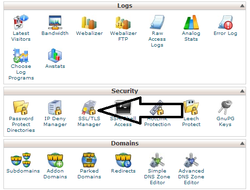
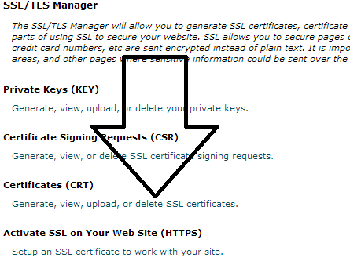
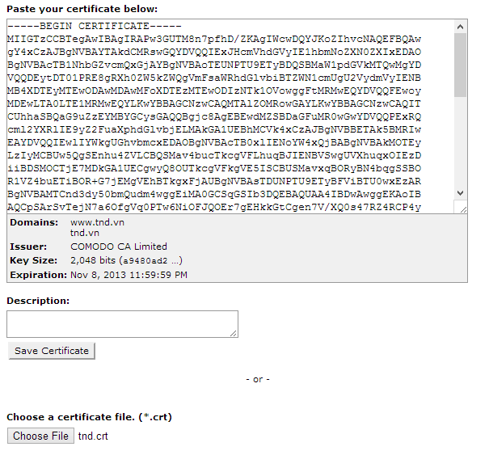
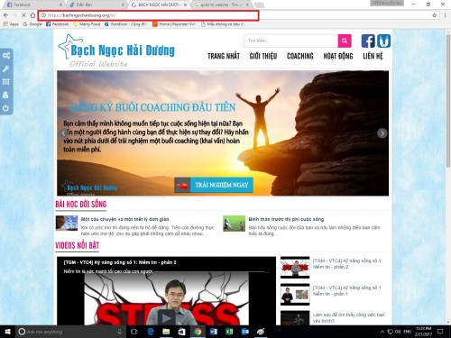

## Tầm quan trọng của SSL đối với website

Xem bài viết sau đây để biết SSL là gì và tại sao cần sử dụng SSL:

- [Google Chrome cảnh báo website không an toàn từ phiên bản Chrome 56](https://nukeviet.vn/vi/news/An-ninh-mang/google-chrome-canh-bao-website-khong-an-toan-tu-phien-ban-chrome-56-467.html)
- [SSL dành cho website Nukeviet - tại sao không?](https://nukeviet.vn/vi/forum/SSL-danh-cho-website-Nukeviet-tai-sao-khong-t33394/)
- [Chứng chỉ SSL giúp tăng lợi thế SEO cho Website](https://nukeviet.vn/vi/forum/Chung-chi-SSL-giup-tang-loi-the-SEO-cho-Website-t33073-p160416/)

## Cài đặt SSL lên Hosting Cpanel

**Bước 1**: Đăng nhập cPanel và click vào nút **SSL/TLS Manager** 

**Bước 2**: Tại trang SSL/TLS Manager ở mục **Certificates (CRT)** click vào phần **Generate, view, upload, or delete SSL certificates**. 

**Bước 3**: Bạn có thể tải tập tin **.CRT** lên hoặc mở nó ra với notepad rồi chép toàn bộ nội dung vào khung **Paste your certificate below**: 

**Bước 4**: ở trang SSL/TLS Manager click vào nút **Setup an SSL certificate to work with your site**. Ở đây bạn lựa chọn SSL để gán vào tên miền của bạn.Tên miền đó phải được add vào host của bạn trước trong 3 dạng sau: Subdomain,Addon và Domain Parked Domain.

Mở chứng chỉ **Intermediate CA** với Notepad rồi sao chép và dán tất cả các nội dung của các file trung gian vào **Bundle CA (CABUNDLE)** hộp. Bạn có thể tải về các chứng chỉ CA Trung cấp phù hợp với sản phẩm SSL của bạn.

**Bước 5**: Bấm nút **Install Certificate**

Bạn sẽ nhận được một thông báo rằng chứng chỉ đã được cài đặt thành công Ví dụ khi load [https://bachngochaiduong.org](https://bachngochaiduong.org) và SSL hiển thị chính xác là được.

Tất cả những nhà cung cấp SSL hiện tại có rất nhiều, nhưng mình xin chia sẻ những nhà cung cấp sau đây mình thấy ok và sài ổn : Geotrust, Comodo SSL, Symantec SSL

Ngoài ra nếu bạn nào sử dụng Hosting khác có thể tham khảo bài viết [Đăng ký SSL miễn phí sử dụng cho Nginx, Apache với Let’s Encrypt](https://nukeviet.vn/vi/news/An-ninh-mang/dang-ky-ssl-mien-phi-su-dung-cho-nginx-apache-voi-let-s-encrypt-468.html).

## Các lỗi khi cài đặt SSL lên Hosting Cpanel

### Lỗi website không tự động chuyển sang dạng https

**Khắc phục**: Các bạn thêm đoạn code sau vào file **.htaccess**

``` text
RewriteEngine OnRewriteCond %{HTTPS} offRewriteRule (.*) https://%{HTTP_HOST}%{REQUEST_URI}
```

### Lỗi SSL hoạt động không chính xác

Tất cả các thẻ HTML có thuộc tính src phải được load từ đường dẫn \<https://>... , nếu không trình duyệt sẽ báo ssl của bạn bị lỗi do dữ liệu website không được mã hóa toàn bộ, hình khóa màu xanh trên thanh địa chỉ sẽ không còn (xem hình dưới). 

Cách xử lý: Tìm và loại bỏ các thành phần bắt đầu từ \<https://>....
