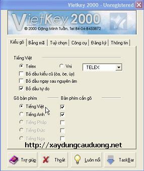
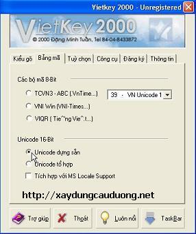
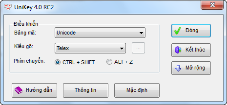
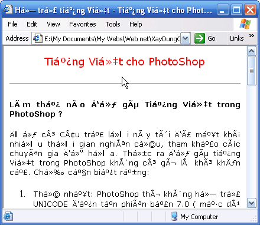
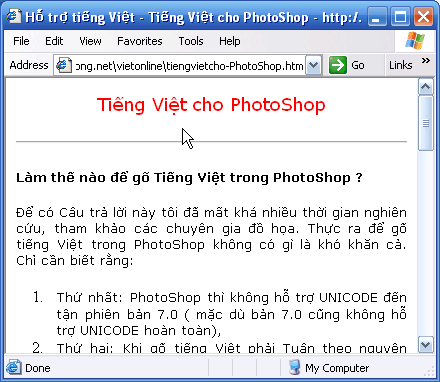

Để tiếp cận với NukeViet dưới góc độ người lập trình, bạn cần nắm vững những kiến thức cơ bản về Windows và Internet cùng một chút về tin học văn phòng. Phần này sẽ cung cấp cho bạn một số điều cơ bản trước khi bắt tay vào lập trình Web cũng như làm việc với PHP nói chung và hệ thống NukeViet nói riêng.

## Bảng mã Unicode và chữ Việt

Để giải quyết vấn đề chữ Việt, trước đây ở Việt Nam đã xuất hiện nhiều loại bảng mã khác nhau. Tuy nhiên, các Font chữ thuộc các bảng mã này không được tích hợp trong Windows nên không phải máy tính nào cũng có sẵn. Do đó xảy ra tình trạng máy thì hiển thị được tiếng Việt, máy thì không.

Kể từ khi bảng mã chuẩn quốc tế Unicode ra đời và WinXP hỗ trợ tuyệt đối cho Unicode thì vấn đề này đã được giải quyết triệt để. Giờ đây, Unicode là lựa chọn tối ưu cho Web Việt.

## Các Font chữ thuộc bảng mã Unicode

Bảng mã Unicode có các font: Times New Roman, Arial, Tahoma, Courier new, Verdana... Khi tạo web, bạn chú ý nên sử dụng các Font này.

## Phần mềm dùng để gõ tiếng Việt

Bộ gõ tiếng Việt phổ biến nhất hiện nay là 2 bộ gõ Vietkey (Vietkey 2000) và Unikey (Unikey NT 4.0)

\* Download các bộ gõ

Bạn có thể Download bản mới nhất và tìm thông tin trợ giúp về Unikey và Vietkey tại các địa chỉ sau:

**Unikey:**

Trang chủ UNIkey: [http://unikey.org](http://unikey.org)

Hoặc: [http://unikey.sourceforge.net](http://unikey.sourceforge.net)

Tải Unikey [http://unikey.org/bdownload.php](http://unikey.org/bdownload.php)

Hướng dẫn: [http://unikey.org/manual/ukmanual.htm](http://unikey.org/manual/ukmanual.htm)

Trợ giúp: [http://unikey.org/manual/ukfaq.htm](http://unikey.org/manual/ukfaq.htm)

**VietKey:**

Trang chủ: [http://vietkey.net/](http://vietkey.net/)

Diễn đàn: [http://www.vietkey.net/forum/](http://www.vietkey.net/forum/)

Download file zip (72KB): [http://www.vietkey.net/forum/attachment.php?attachmentid=12](http://www.vietkey.net/forum/attachment.php?attachmentid=12)

\* Cấu hình bộ gõ theo bảng mã unicode

\- Với Vietkey2000, bạn chọn mục Kiểu gõ, và Bảng mã Unicode như sau (xem hình 1 và 2)

 

Nhấp 'TaskBar' để ẩn VietKey vào khay hệ thống (cạnh đồng hồ).

\- Với UNIkey 4.0: Bạn chọn bảng mã là Unicode, kiểu gõ là Telex hay tùy ý bạn (xem hình 3).



Hình 3: Cấu hình cho bộ gõ Unikey

``` text
       Sau đó nhấp 'Đóng' để ẩn Unikey vào khay hệ thống.
```

Chú ý:

- Chỉ được dùng một trong hai bộ gõ là Vietkey hoặc Unikey, không được chạy đồng thời cả hai chương trình.

- Bạn nên sử dụng bộ gõ Unikey vì bộ gõ này nhỏ gọn, ít lỗi và chứa nhiều tiện ích thuận tiện trong lập trình, tạo Web.

## Unicode UTF-8 và tiếng Việt trên Web

Như đã nói ở trên, Unicode là lựa chọn tối ưu cho Web Việt. Tuy nhiên, Unicode cũng có hai dạng là Unicode dựng sẵn và Unicode tổ hợp, trong đó Unicode dựng sẵn cho kết quả tốt hơn. Bạn nên chọn bảng mã Unicode dựng sẵn trong mọi trường hợp có thể.

Trong định dạng phần văn bản trên Web, bạn cần khai báo Font. Các Font phải là bộ Font thuộc bảng mã Unicode như đã giới thiệu ở trên.

Để xác lập bảng mã Unicode cho website và thông báo cho trình duyệt biết để hiển thị đúng, bạn cần chèn đoạn mã sau vào mỗi trang Web:

\<meta http-equiv="Content-Type" content="text/html; charset=utf-8"\>

Đoạn mã này được chèn trong cặp thẻ \<head\> ... \</head\>

Nếu trang Web không có đoạn mã này, nhiều khi trình duyệt sẽ hiển thị không đúng, người dùng phải mất công chọn lại Encoding cho trình duyệt (xem hình 4 và 5).

 

UTF-8 là Unicode dựng sẵn, chẳng những giảm đến 30% dung lượng trang HTML, tăng tốc truy cập mà bạn sẽ thấy tiếng Việt ngay cả khi soạn thảo bằng HTML. Để lấy ví dụ minh họa, ta xét 2 trường hợp khi gõ cụm từ: Unicode tổ hợp.

- Nếu sử dụng Unicode tổ hợp thì mã HTML sẽ được dịch thành:

UNICODE tổ hợp

- Nếu sử dụng Unicode dựng sẵn (utf-8) thì trang HTML sẽ được dịch thành:

UNICODE tổ hợp

- Rõ ràng là Unicode dựng sẵn dễ đọc hơn (khi lập trình), số ký tự (trong mã nguồn) ít hơn =\> dung lượng trang nhỏ hơn =\> tốc độ duyệt web nhanh hơn.

- Trong hệ thống NukeViet, các thông số font và bảng mã cho tiếng Việt đã được xác lập sẵn nên bạn không cần lo lắng quá nhiều về điều này.
