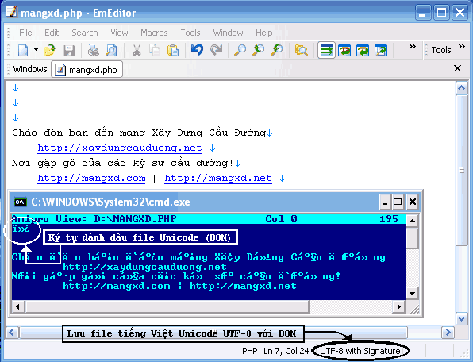
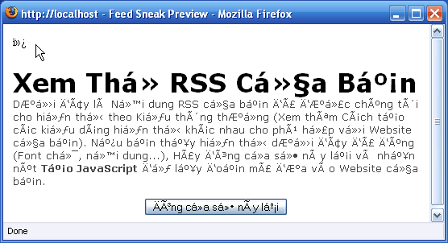
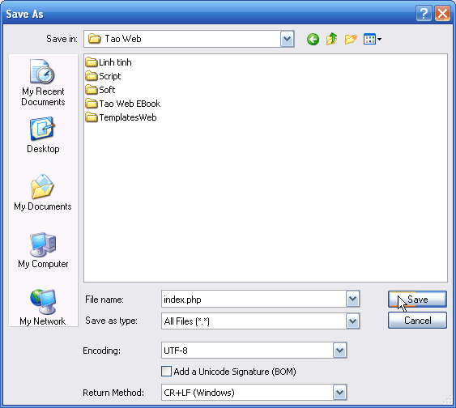

- Nếu bạn sử dụng tiếng Việt Unicode trong file PHP, bạn phải lưu file với mã UTF-8, và khi lưu nhớ bỏ tuỳ chọn Save BOM Signature. Nếu không, 3 ký tự đánh dấu Unicode sẽ được tự động chèn vào đầu file mã nguồn PHP. Khi bạn mở file ra xem bằng một chương trình không hỗ trợ Unicode, bạn sẽ thấy có 3 ký tự ở ngay đầu file (xem hình 1).

- Với nhiều chương trình soạn thảo văn bản hỗ trợ Unicode (Tiêu biểu là Notepad trong WinXP) sẽ không hiển thị ra màn hình 3 ký tự này khi bạn mở file (vì vậy bạn sẽ không biết là có 3 ký tự này ở đầu file) mặc dù nó vẫn tồn tại. Trong nhiều trường hợp, nó có thể gây ra một số lỗi không lường trước được. Ví dụ như một dòng báo lỗi PHP hiện trên Web. Tệ hơn, nó có thể bị hỏng định dạng font (xem hình 2)

- Ảnh hưởng của 3 ký tự BOM đối với hệ thống NukeViet tuy không nghiêm trọng nhưng cũng khá khó chịu. Dễ thấy nhất là việc các thành viên phàn nàn rằng khi dùng Notepad mở các file PHP trong thư mục Block của hệ thống NukeViet để chỉnh sửa, sau khi lưu file lại thì xảy ra một hiện tượng tăng khoảng cách giữa các Block hiện thị trên website gây mất mỹ quan cho trang Web. Tuy nhiên, rắc rối thực sự lớn khi bạn phải thực hiện Backup dữ liệu từ một file SQL chứa dữ liệu là tiếng Việt Unicode. Nếu không may chương trình Backup lại lưu file SQL mà đầu file có chứa 3 ký tự BOM thì phpMyAdmin sẽ không thể Backup và gây ra lỗi. Khi đó bạn phải tìm cách bỏ đi 3 ký tự BOM này.

- Để tránh hiện tượng trên, bạn nên dùng EmEditor, khi bạn lưu file lần đầu tiên, hoặc lúc bạn Save as, bạn chỉ cần chọn mục Code Page là UTF-8 và bỏ chọn mục Add a Unicode Signature (BOM) đi là xong. Tùy chọn này sẽ được EmEditor ghi nhận. Từ lần lưu file thứ hai trở đi, hoặc khi bạn mở file đã được save rồi thì bạn không cần phải chọn lại nữa (xem hình 3).

