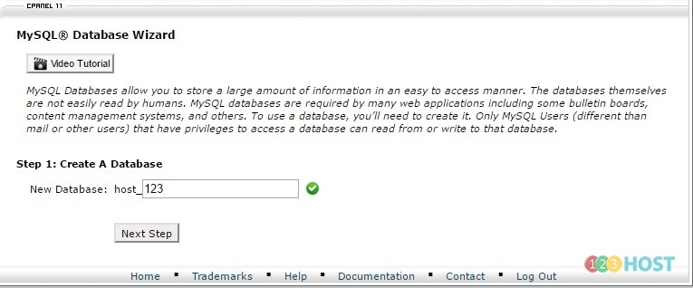
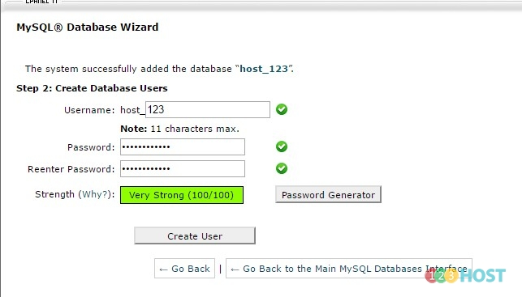
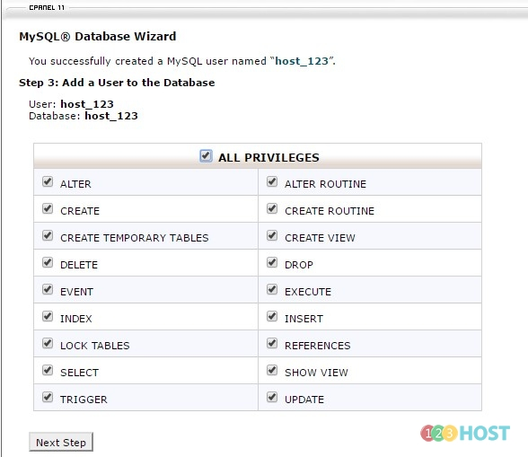

Chào các Bạn,

Mình xin hướng dẫn cách tạo 1 database bằng công cụ wizard.

Bước 1: Đăng nhập Cpanel --\> Tìm đến mục Databases --\> Chọn công cụ MySQL Database Wizard

Bước 2: Điền tên database muốn tạo

Bước 3: Điền tên và mật khẩu của user sử dụng database

Bước 4: Gán quyền của user vừa tạo với databse.

Bước 5: Sau khi tạo thành công

 
