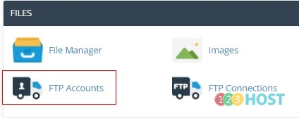
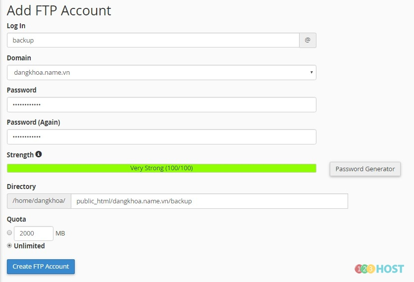
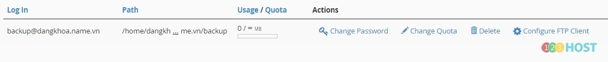
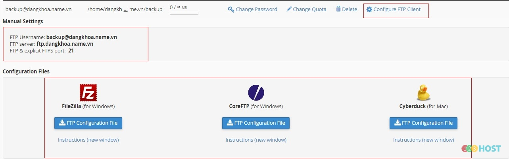

Chào các Bạn,

cPanel là hosting control panel rất phổ biến, hiện rất nhiều các nhà cung cấp hosting sử dụng control pannel này. Mình xin hướng dẫn tạo tài khoản FTP trên Cpanel. Hình ảnh dưới đây được lấy từ [hosting của 123HOST](https://123host.vn/web-hosting.html)

Bước 1: Đăng nhập Cpanel –\> Mục FILES –\> Chọn FTP Accounts

Bước 2: Điền các thông tin tạo tài khoản –\> tên tài khoản –\> mật khẩu –\> Đường đẫn thư mục home cho tài khoản –\> hạn mức dung lượng cho tài khoản. –\> Create FTP Account

Bước 3: Sau khi tạo thông tin tài khoản được hiển thị như sau:

Bước 4: Để sử dụng Khách hàng bấm vào mục Configure FTP Client sẽ thấy hiển thị thông tin đăng nhập và phần mềm gợi ý sử dụng

