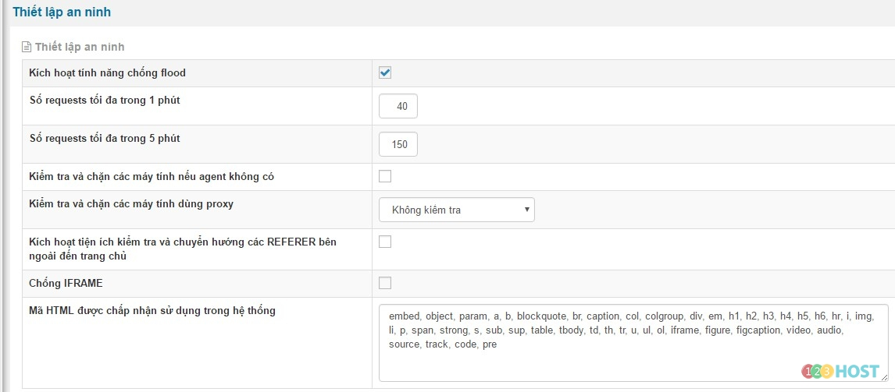
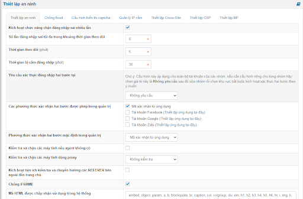
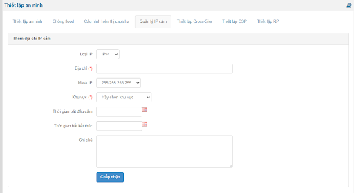
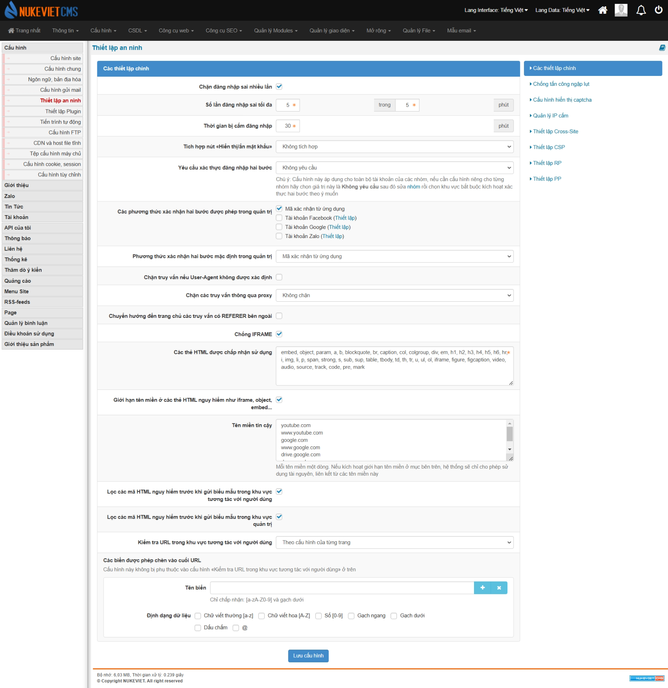
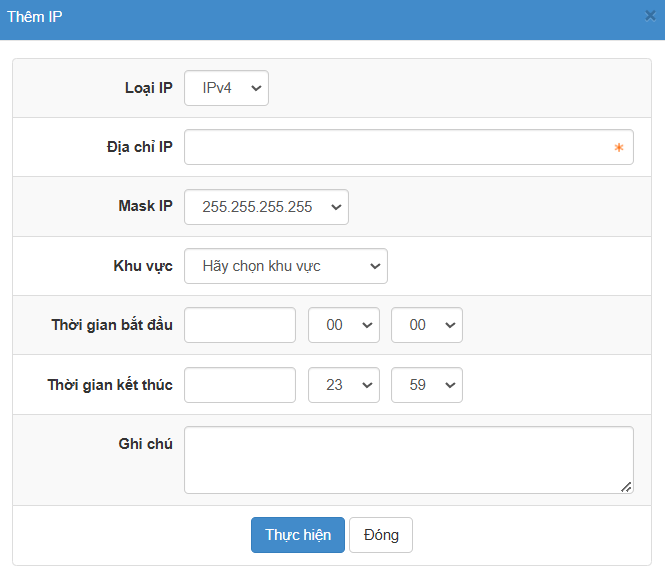

Đăng nhập khu vực quản trị với quyền quản trị tối cao **(ACP)/Cấu hình/Thiết lập an ninh**



**- Kích họat tính năng chống flood:** Là hình tấn công theo phước thức gửi request liên tục đến sever khiến hệ thống quá tải, sinh nhiều rác thừa, hết băng thông... nếu có IP thực hiện request liên tục hệ thống sẽ tự động khóa IP đó trong thời gian nhất định.

**- Số requests tối đa trong 1 phút, Số requests tối đa trong 5 phút**: Sử dụng trong trường hợp kích họat tính năng chống flood. kết hợp với tính năng chống flood.

**- Kiểm tra và chặn các máy tính nếu agent không có:** Mỗi user kết nối đến máy chủ sẽ có một user agent, vì lý do nào đó trên đường truyền đi user bị mất trường user agent khi kết nối đến server sẽ bị lỗi:

We're sorry. The software you are using to access our website is not allowed. Some examples of this are e-mail harvesting programs and programs that will copy websites to your hard drive. If you feel you have gotten this message in error, please send an e-mail addressed to admin. \<Your I.P. address\> has been logged. Thanks.

**- Kiểm tra và chặn các máy tính dùng proxy:** Là phương thức ẩn danh truy cập trên internet. những máy dùng proxy sẽ bị chặn

**- Kích hoạt tiện ích kiểm tra và chuyển hướng các REFERER bên ngoài đến trang chủ:** Khi người dùng click vào 1 link liên kết trên site của bạn thông qua việc tìm kiếm google hoặc khác, thì đều dẫn đến trang chủ

**- Chống IFRAME:** iframe được sử dụng nhiều trong phương thức tấn công ddos, bật chức năng này sẽ giúp chèn thêm đoạn mã sau giúp chống hình thức ddos qua iframe

\<script language="JavaScript"\>

``` text
 if (top.location != self.location)
    {top.location = self.location}
```

\</script\>

**- Mã HTML được chấp nhận sử dụng trong hệ thống:** Bật chức năng cho phép sử dụng các thẻ HTML được quy định trước.

**- Cấu hình hiển thị captcha:**

Cấu hình hiển thị captcha: chọn mục hiển thị captcha Loại captcha: NukeViet cung cấp 3 loại Mặc định, CoolPHP Captcha và reCAPTCHA. Nếu chọn Mặc định, CoolPHP Captcha cần thiết lập các thông số:

- Số ký tự của captcha: số ký tự hiển thị
- Kích thước captcha: Kích thước ảnh captcha

Nếu chọn reCAPTCHA thì cần thiết lập 3 thông số: Site key, Secret key, Kiểu xác nhận. Để lấy Site key, Secret key truy cập vào [https://www.google.com/recaptcha/admin](https://www.google.com/recaptcha/admin)

> Lưu ý: ReCAPTCHA được bổ sung kể từ phiên bản NukeViet 4.1.01

**- Thêm địa chỉ IP cấm:**

Địa chỉ: Nhập IP cần cấm Mask IP: Mask cấm truy cập Khu vực: Áp dụng Thời gian bắt đầu, kết thúc: Thời gian áp dụng Ghi chú: Ghi chú cùng hiển thị thông báo cấm truy cập khi người dùng truy cập

**Giao diện phiên bản NukeViet 4.5.01:**



Có các tính năng được thành các tab như:

\- Thiết lập an ninh:

- Kiểm tra và chặn các máy tính nếu agent không có: Mỗi user kết nối đến máy chủ sẽ có một user agent, vì lý do nào đó trên đường truyền đi user bị mất trường user agent khi kết nối đến server sẽ bị lỗi

- Kiểm tra và chặn các máy tính dùng proxy: Là phương thức ẩn danh truy cập trên internet. những máy dùng proxy sẽ bị chặn

- Kích hoạt tiện ích kiểm tra và chuyển hướng các REFERER bên ngoài đến trang chủ: Khi người dùng click vào 1 link liên kết trên site của bạn thông qua việc tìm kiếm google hoặc khác, thì đều dẫn đến trang chủ

- Chống IFRAME: iframe được sử dụng nhiều trong phương thức tấn công ddos, bật chức năng này sẽ giúp chèn thêm đoạn mã sau giúp chống hình thức ddos qua iframe

- Mã HTML được chấp nhận sử dụng trong hệ thống: Bật chức năng cho phép sử dụng các thẻ HTML được quy định trước.

\- Chống flood: Là hình tấn công theo phước thức gửi request liên tục đến server khiến hệ thống quá tải, sinh nhiều rác thừa, hết băng thông… nếu có IP thực hiện request liên tục hệ thống sẽ tự động khóa IP đó trong thời gian nhất định.

\- Cấu hình hiển thị captcha

\- Quản lý IP cấm:



- Địa chỉ: nhập IP cần cấm

- Mask IP: mask cấm truy cập

- Khu vực: khu vực áp dụng

- Thời gian bắt đầu, kết thúc: thời gian áp dụng

- Ghi chú: ghi chú cùng hiển thị thông báo cấm truy cập khi người dùng truy cập

\- Thiết lập Cross-Site

\- Thiết lập CSP

\- Thiết lập RP

### Phiên bản NukeViet 4.5.06

- Giao diện tương tự phiên bản 4.6.0

### Phiên bản NukeViet 4.6.0

- Giao diện thay đổi



- Quản lý IP cấm: Khi bấm nút *‘Thêm IP’* sẽ hiện ra form thay vì hiển thị sẵn



# Nếu IP của bạn bị chặn liên tục

có thể thực hiện 1 trong các cách sau:

1\) Nếu IP của bạn đang dùng là IP cố định có thể thêm IP của mình vào danh sách các IP không bị chặn bằng cách

- Đăng nhập quyền quản trị tối cao
- Truy cập link: [http://domain/admin/index.php?language=vi&nv=settings&op=security](http://domain/admin/index.php?language=vi&nv=settings&op=security)
- Chọn Tab chống flood
- Thêm IP của mình vào phần: Thêm IP bỏ qua kiểm tra flood

2\) Sử dụng cloudflare.com để làm tường lửa của site:

- Đăng ký tài khỏan tại cloudflare.com, sau đó thêm website vào
- Trong quá trình cấu hình sẽ cần trỏ DNS nên sẽ cần phải có tài khoản quản trị domain
- Sau khi cấu hình cloudflare thành công Truy cập link: [http://domain/admin/index.php?language=vi&nv=settings&op=security](http://domain/admin/index.php?language=vi&nv=settings&op=security)
- Chọn Tab chống flood
- Tắt tính năng: Kích hoạt tính năng chống flood và lưu lại
