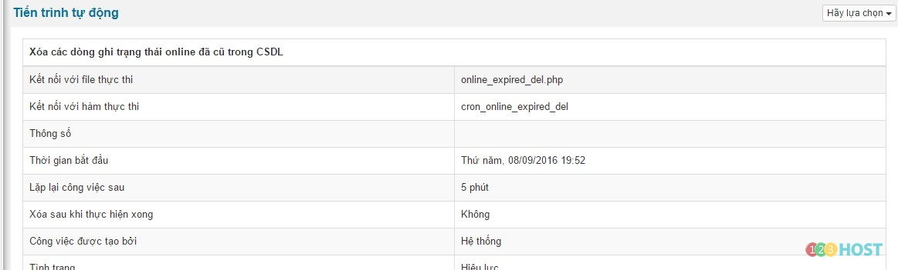
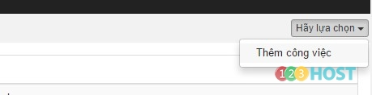
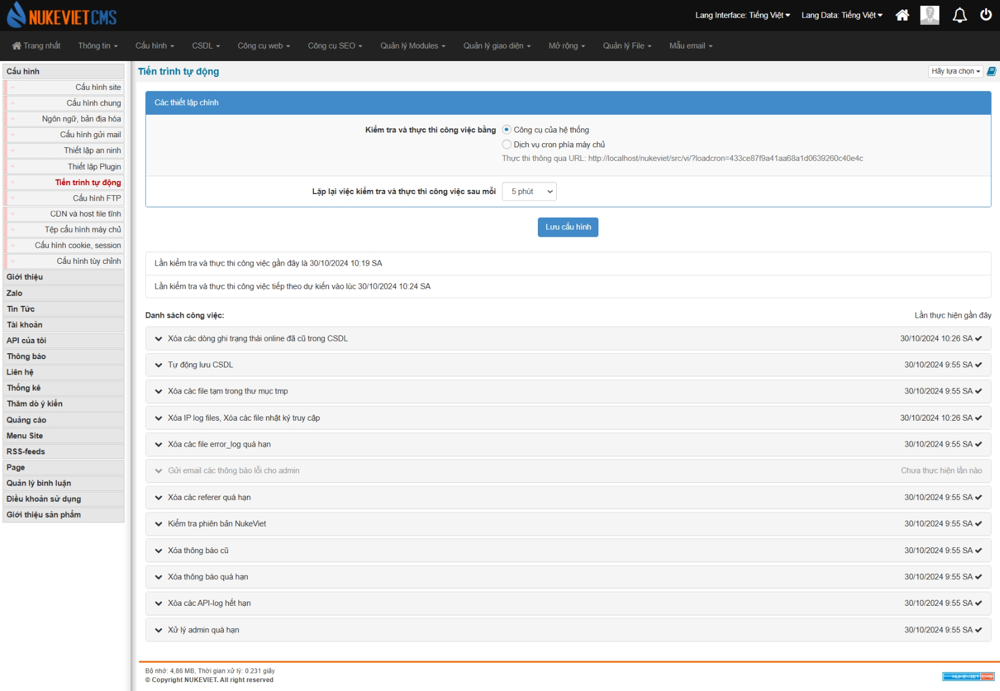

Đăng nhập khu vực quản trị với quyền quản trị tối cao **(ACP) / Cấu hình / Tiến trình tự động**

Cronjobs hệ thống đảm nhận các chức năng quan trọng của hệ thống, đảm bảo sự họat động suôn sẻ của hệ thống theo công việc đã được định trước, thường được kích họat sẵn sau khi cài đặt NukeViet.

1\. Thêm một Cronjobs mới

Để thêm một Cronjobs, tại danh sách Cronjobs hiện có, chọn Thêm công việc ở vị trí góc trên – phải.

Tại biểu mẫu thông tin, bạn cần lưu ý các thông tin:

Tên công việc: Đặt tên cronjobs

Kết nối với file thực thi:Kết nối đến file cronjobs (Các file này đặt ở /includes/cronjobs)

Kết nối với hàm thực thi: Nhập tên hàm chứa nội dung thực thi, tên hàm bắt đầu bằng cron\_)

Thông số: Nhập tham số của hàm (Nếu có)

Thời gian bắt đầu: Thời gian bắt đầu kích hoạt cronjobs

Lặp lại công việc sau: Nhập thời gian (phút) cho mỗi chu kỳ tự động thực hiện

Xóa sau khi thực hiện xong: Tự động xóa cronjobs sau khi thực hiện xong lần đầu tiên.

Nhấn Thực hiện để hoàn tất việc thêm cronjobs

- Giao diện thay đổi

