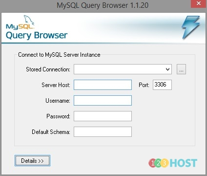

Chào các Bạn,

Để thực hiện kết nối đến cơ sở dữ liệu từ xa chúng ta sẽ sử dụng port-forwarding thông qua một SSH tunnel với lệnh: ssh –L 3306:localhost:3306 root@61.14.232.x Cú pháp của lệnh ssh: ssh –L \<localport\>hostname\<remoteport\> \<username\>@\<servername\> Khi đã có MySQL chạy trên hệ thống có thể dùng công cụ MySQL Query Browser để truy xuất.

