- Phiên bản mới nhất ổn định của AppServ là 2.5.10, Bạn có thể tải bản này về từ website: [http://www.appservnetwork.com/](http://www.appservnetwork.com/)
- Hệ điều hành được sử dụng ở đây là Windows, nếu bạn sử dụng Ubuntu hay Linux, xin xem [Hướng dẫn cài NukeViet trên Ubuntu (sử dụng Xampp)](/nukeviet/setup/localhost_ubuntu)

**Lưu ý:**

- Hiện tại có phiên bản AppServ 2.6.0, bạn không nên sử dụng bản này vì php và mysql đều là các bản dev và alpha không ổn định khi sử dụng

- Trước khi cài đặt chương trình, bạn hãy xóa bỏ tất cả những chương trình hỗ trợ cài loaclhost đã cài trước đó, như Apache Web Server, Mysql, PHP…, đồng thời xóa file php.ini nằm trong thư mục hệ thống C:/windows/

- Sau khi tiến hành tất cả các bước chuẩn bị đã nêu ở trên, bạn tiến hành cài đặt chương trình.

## Cài đặt AppServ

Bước 1: Chạy file appserv-win32-2.5.10.exe để tiến hành cài đặt. Cửa sổ Welcome của màn hình Setup hiện ra. Nhấp Next để tiếp tục (xem hình 1)

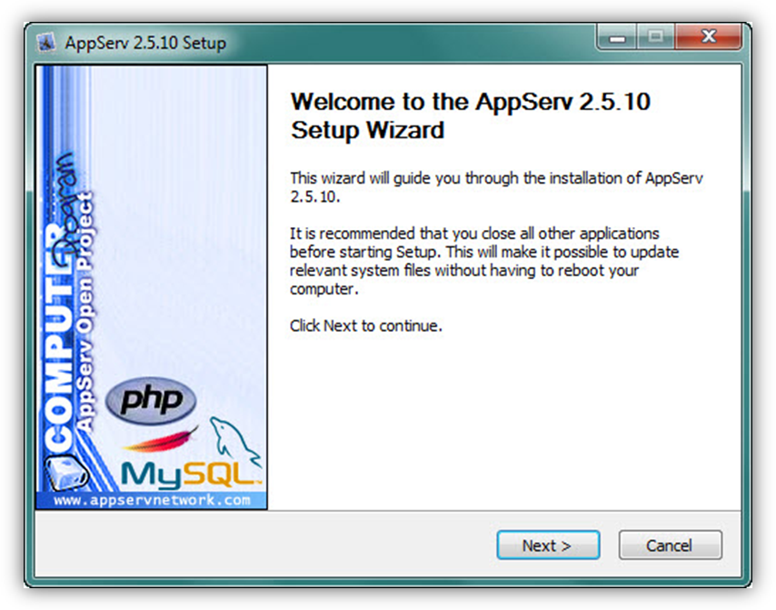

Bước 2: Thông tin bản quyền : AppServ xuất bản theo giấy phép GNU/GPL License. Bạn cần đọc thông tin này trước khi cài đặt. Nếu tiếp tục cài đặt cần click vào I Agree để chuyển sang bước kế tiếp. Nếu không đồng ý bạn click vào Cancel để thoát quá trình cài đặt.

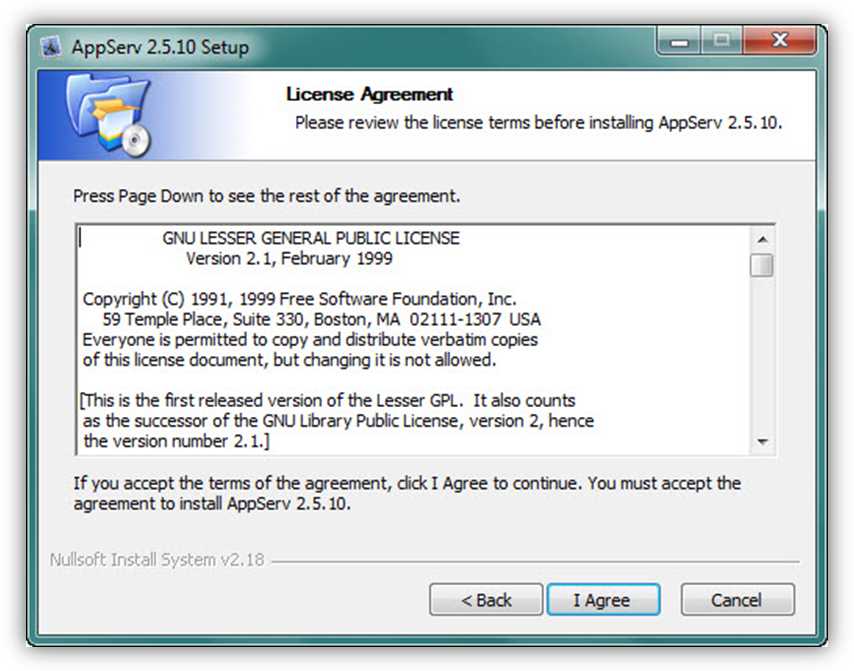

Bước 3: Chọn thư mục cài đặt. Bạn nên chuyển thư mục lưu trữ AppServ sang ổ D và nhấp Next để tiếp tục (xem hình 3).

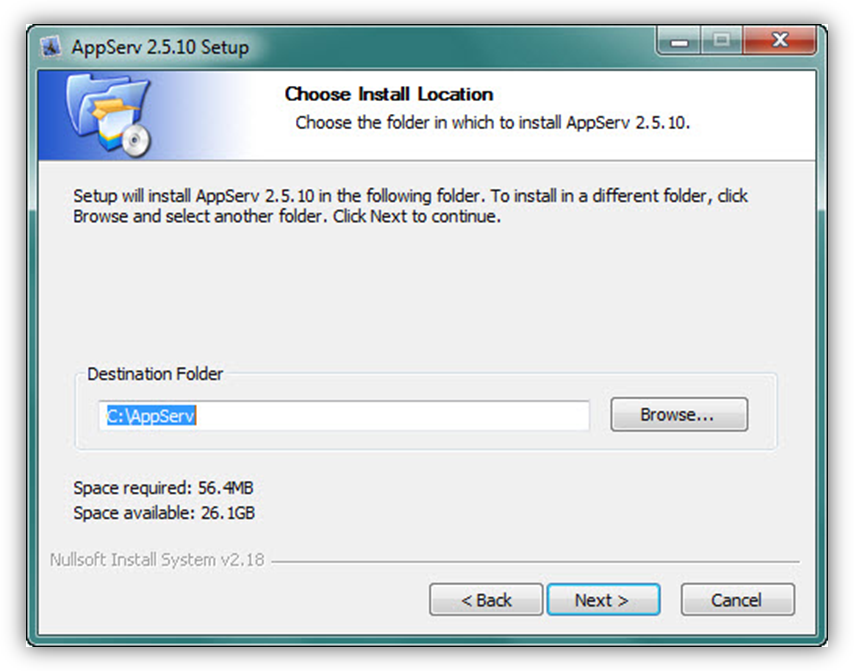

Bước 4: Chọn các thành phần cài đặt.

Ta để mặc định (chọn hết toàn bộ), nhấp Next để tiếp tục (xem hình 4).

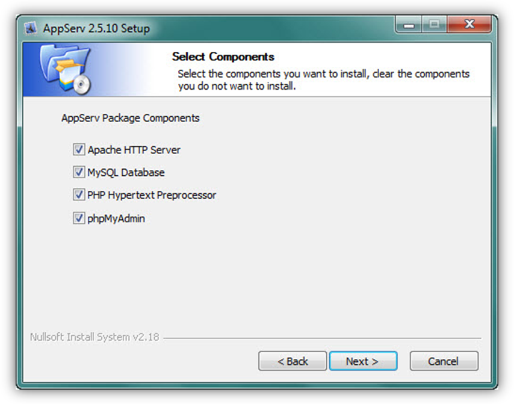

Bước 5: Khai báo cho quá trình cài đặt Apache Server

- Tại bước này bạn cần khai báo Server name, Administrator’s Email address, HTTP Port. Ngoại trừ ô Administrator’s Email address có thể thay đổi, các ô khai báo khác hãy để mặc định như chương trình yêu cầu:

- Server name: localhost;

- Administrator’s Email address: admin@localhost.com

- HTTPPort: 80.

Sau đó nhấp Next để tiếp tục (xem hình 5).

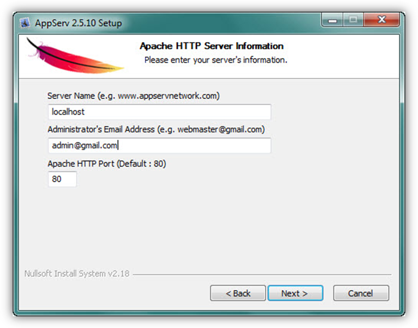

Bước 6: Khai báo cho quá trình cài đặt MySQL

Phần khai báo thông tin để cài đặt MySQL bao gồm: User name, Password và Charset. Hãy khai báo tùy ý 2 mục đầu, mục Charset để mặc định là latin1 (Chú ý: chỉ dùng các chữ cái latin, không viết từ có khoảng trắng hay có dấu tiếng Việt). Trong quá trình cài đặt AppServ đòi hỏi bạn phải nhớ Username vì bạn sẽ phải khai báo nó khi cài đặt NukeViet sau này. Password không cần thiết vì bạn cài trên localhost, do đó nên để trống. Nhấp Next để tiếp tục (xem hình 6).

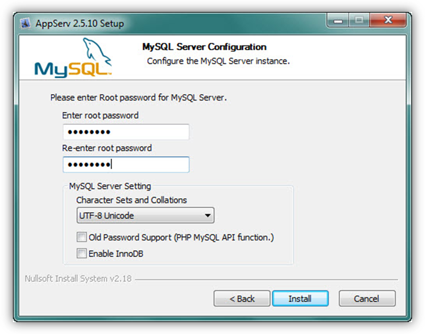

Chờ trong giây lát, quá trình cài đặt sẽ diễn ra

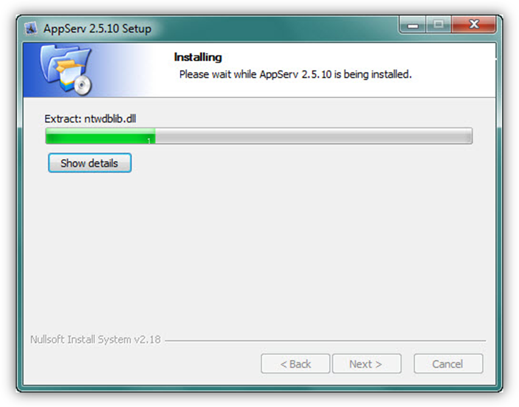

Bước 7: Kết thúc cài đặt và khởi động chương trình

Nhấp Close để kết thúc quá trình cài đặt và khởi động Apache & MySQL (xem hình 7)

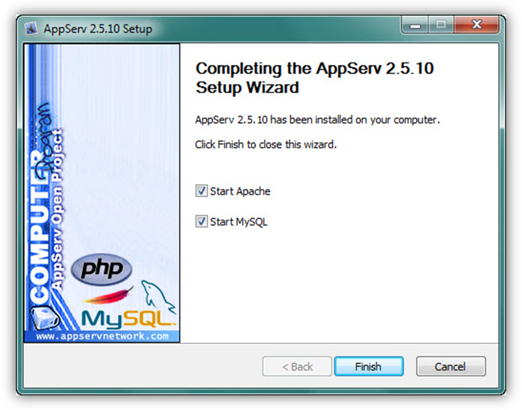

Apache & MySQL sẽ được tự động khởi động ngay sau khi kết thúc cài đặt

Bước 8: Kiểm tra kết quả.

Mở Internet Explorer, gõ địa chỉ [http://localhost/](http://localhost/) nếu thấy trang web tương tự như hình dưới tức là bạn đã cài thành công appserv.

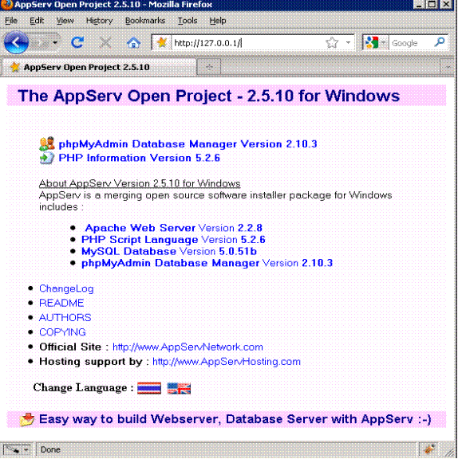

Sau khi cài xong appserv 2.5.10 máy tính của bạn sẽ có các chương trình sau:

- Apache Web Server Version 2.2.8

- PHP Script Language Version 5.2.6

- MySQL Database Version 5.0.51b

- phpMyAdmin Database Manager Version 2.10.3

### Đăng nhập thử vào phpMyAdmin

Hãy gõ localhost/phpMyAdmin vào thanh Address của trình duyệt web. Một hộp thoại hiện ra yêu cầu nhập User Name và Password để đăng nhập vào phpMyAdmin (xem hình 9).

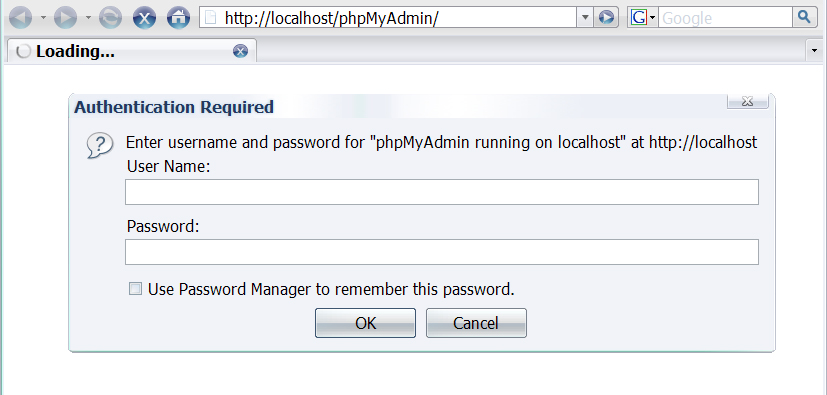

\- Hãy nhập như sau:

- Username : root

- Password : (điền password mà bạn đã chọn ở phần cài đặt trên)

Nếu nhập đúng, màn hình của phpMyAdmin sẽ hiện ra như sau:

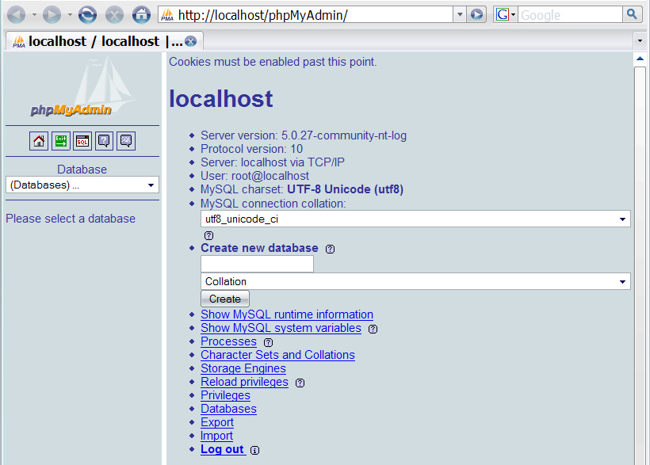

- Để đăng xuất, bạn nhấn nút Log out.

## Các lỗi hay gặp phải khi cài AppServ và cách khắc phục

### Nếu tôi quên root password của MySQL Server thì phải làm sao?

Trong trường hợp bạn quên password mà mình đã chọn khi cài đặt ban đầu thì hãy làm theo các bước sau:

- Từ menu Start của Windows, chọn Programs \> AppServ \> Reset MySQL Root Password. Cửa sổ chương trình hiện ra như sau:

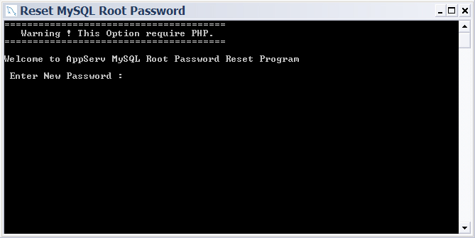

- Bây giờ, hãy gõ lại password mới cho MySQL Server.

- Nếu bạn reset root password thành công thì cửa sổ chương trình sẽ hiện ra như sau:

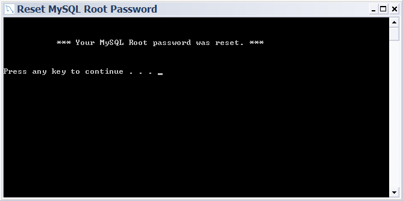

- Cuối cùng, nhấn phím bất kì để đóng chương trình.

### Không cài đặt được NukeViet 4

NukeViet 4 cần có thêm hai thư viện php_mcrypt, và php_pdo_mysql

Mở file C:\WINDOWS\php.ini

Tìm đến dòng

;extension=php_mcrypt.dll Sửa thành extension=php_mcrypt.dll

Tìm đến dòng ;extension=php_pdo.dll

Sửa thành extension=php_pdo.dll extension=php_pdo_mysql.dll

Copy file C:\AppServ\php5\libmcrypt.dll Vào thưu mục C:\AppServ\Apache2.2\bin

Khởi động lại Apache Restart

## Bật Module Rewrite của Apache.

Module Rewrite để thiết lập các ứng dụng tối ưu hóa liên kết .

Bạn chỉ cần di chuyển đến thư mục D:\AppServ\Apache2.2\conf (đường dẫn này thay đổi tương ứng với đường dẫn cài đặt của bạn) và tìm file httpd.conf.

Mở file này bằng notepad và tìm đoạn:

\#LoadModule rewrite_module modules/mod_rewrite.so

Bỏ dấu \# phía trước nó

Sau đó save file này lại và restart máy (hoặc có thể restart Apache cho nhanh).

## Lỗi khi cài appserv

Nếu sau khi cài bạn gặp lỗi không thể kết nối với MySQL thì có lẽ đã có lỗi do lần cài đặt trước đó bạn để sót file cũ, hãy gỡ AppServ bằng cách :

- Vào menu Start \> All Program \> AppServ \> Uninstall AppServ và thực hiện gỡ toàn bộ chương trình, kể cả các chương trình phụ trợ (chọn yes đối với tất cả các yêu cầu).

- Sau khi máy tính khởi động lại, hãy:

Vào thư mục: C:/AppServ và xóa tất cả các file và thư mục trong đó.

Vào C:\Windows và xóa 2 file: php.ini và my.ini

Cài đặt lại appserv theo hướng dẫn ở phần trước.
