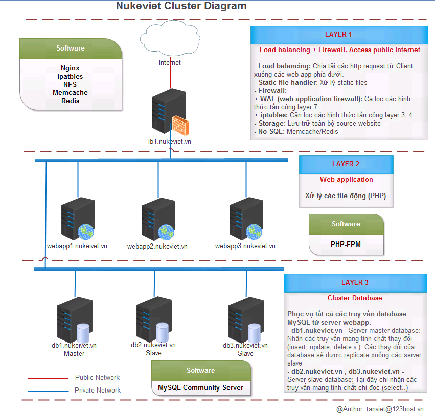
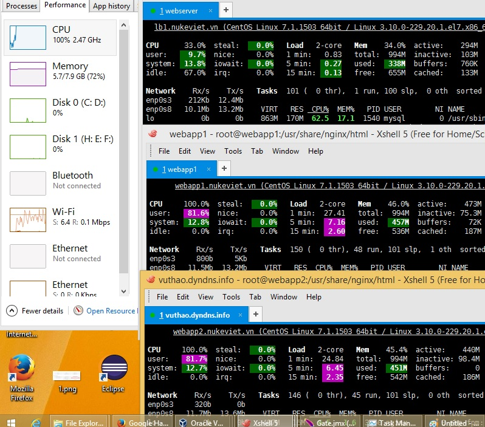

project này làm cho NukeViet 4 theo hướng tối ưu NukeViet cho các site có lượng truy cập lớn và rất lớn, không làm cho các site nhỏ, hay trên các hosting được. Khi xây dựng cần có nhiểu server riêng để cấu hình mới (Hoặc sử dụng trên các VPS mua tại các Cloud có thể thiết lập được Private Network)

## 1) Mô hình áp dụng:

Mô hình này được bạn Việt bên 123host đưa ra. Vũ Thảo là người thực hiện



Mô hình này đáp ứng được vấn đề gì? Đáp ứng được chia tải PHP và MySQL cho những website traffic cực lớn. Có đáp ứng được dự phòng không? Có nhưng chưa đủ, mới chỉ dự phòng cho các server webapp, database slave.

## 2) Các lưu ý

Mô hình này là mô hình này mình cố tình làm đơn giản nhất để phù hợp với cộng đồng. Ngoài các chú thích đã có trên hình, có một số lưu ý như sau:

**Server lb1.nukeviet.vn:**

Hiện chỉ chạy 1 mình, chưa có server dự phòng cho nó (HA - high availability). Nếu cần, mình sẽ lên một mô hình HA đầy đủ, tuy nhiên sẽ sử dụng thêm một số công nghệ phức tạp nên ban đầu mình sẽ không đưa vào. Khi có 1 trong 3 server web app gặp sự cố, Load balancer sẽ tự động tách nó ra, đảm bảo hệ thống hoạt động xuyên suốt. Như vậy các server webapp này không những chia tải mà còn dự phòng lẫn nhau. Thuật toán load balancing: Tùy chọn Caching phía server? Tất nhiên là được, nếu cache sẽ cache tại đây. Nhưng lại là vấn đề nâng cao và mình không đề cập tại mô hình này

**Source code** (bao gồm các file php và các file static) sẽ được lưu tập trung tại server lb1.nukeviet.vn. Các server webapp sẽ mount đến server lb1 qua network sử dụng NFS (network file system).

Lưu ý về perfomance: Nếu source website thường xuyên thay đổi (ví dụ xóa / tạo file liên tục xuống ổ cứng) thì NFS không phải là sự lựa chọn tối ưu. Lúc này có thể lưu file phân tán tại chính server webapp hoặc dùng công nghệ khác.

**Lưu static file tại CDN?:**

Nếu có CDN riêng thì sẽ để static file tại CDN hoặc CDN pass traffic static và LB1 và cache tại CDN. Phần này không ảnh hưởng đến mô hình.

**MySQL** Source code nukeviet cần hỗ trợ master/slave MySQL để điều hướng truy vấn mang tính chất thay đổi (insert, update, delete.v.v.) sang server Master, Các truy vấn chỉ đọc sẽ điều hướng đều sang các server slave còn lại. Tại đây server Master database cũng chưa có server dự phòng cho nó. Và cũng như mình đã trình bày, dự phòng này sẽ được đưa vào một mô hình nâng cao khác, không phải mô hình này.

**Session** Nukeviet sử dụng default session của server thì có thể dùng Memcache để lưu session tập trung tại server lb1.nukeviet.vn (cấu hình session.handler và session.save_path tại php.ini)

## 3) Tiến hành Cài đặt

`Ghi chú: Hiện tại project này đang xây dựng, hiện tại các phần sau chưa xử lý được`

1.  Xây dựng hệ thống MySQL master/slave (Phần này làm sau cùng do hiện tại nếu tách MySQL ra 1 máy chủ riêng thì CPU, IO load rất thấp).

### Cài đặt Nginx trên lb1.nukeviet.vn

Sử dụng hệ điều hành CentOS 7.1, server này có 2 cạc mạng

``` text
Public Network 192.168.100.101 để nối thẳng ra internet
Private Network 192.168.56.100 để kết nối với các server nội bộ.
```

**Bước 1: Cập nhật HDH**

``` text
yum update -y
```

**Bước 2: Nạp package**

Do NGINX không có sẵn trong gói Yum mặc định của CentOS nên chúng ta phải nạp một package từ bên ngoài vào.

Sau đó tạo 1 file tên là nginx.repo trong thư mục /etc/yum.repos.d/ rồi copy đoạn dưới đây vào:

``` text
[nginx]
name=nginx repo
baseurl=http://nginx.org/packages/centos/$releasever/$basearch/
gpgcheck=0
enabled=1
```

Nếu bạn muốn dùng NGINX bản mới nhất thì dùng đoạn dưới: (Tôi chọn bản này)

``` text
[nginx]
name=nginx repo
baseurl=http://nginx.org/packages/mainline/centos/$releasever/$basearch/
gpgcheck=0
enabled=1
```

**Bước 3: Cài đặt NGINX**

``` text
sudo yum install nginx -y
sudo systemctl start nginx
sudo systemctl enable nginx
sudo firewall-cmd --permanent --zone=public --add-service=http 
sudo firewall-cmd --permanent --zone=public --add-service=https
sudo firewall-cmd --reload
```

**Bước 4: Cấu hình NGINX**

``` text
## Main configuration file ##
/etc/nginx/nginx.conf
 
## Virtualhost configuration files on ##
/etc/nginx/sites-available/
/etc/nginx/sites-enabled/
 
## Other config files on (if needed) ##
/etc/nginx/conf.d/
```

Mở file /etc/nginx/nginx.conf

Cấu hình `worker_processes` bằng số CPU của máy (Tìm số CPU bằng lệnh `cat /proc/cpuinfo |grep processor`)

Cấu hình các thông số trong thẻ'' http \{''

``` text
server_tokens off;
```

Khởi động lại nginx: sudo systemctl restart nginx sau đó truy cập vào địa chỉ IP để kiểm tra

### Cài đặt Memcached

Có thể cài đặt trên lb1.nukeviet.vn, hoặc tạo thêm máy memcached.nukeviet.vn

``` text
yum install -y memcached
sudo systemctl start memcached
sudo systemctl enable memcached
```

Open Memcached Port (11211) on Firewall:

``` text
firewall-cmd --zone=internal --add-source=192.168.56.101/32 --permanent
firewall-cmd --zone=internal --add-source=192.168.56.102/32 --permanent
firewall-cmd --zone=internal --add-source=192.168.56.103/32 --permanent
firewall-cmd --zone=internal --add-port=11211/tcp --permanent
firewall-cmd --reload
```

### Cài đặt PHP trên webapp1.nukeviet.vn

Trước khi cài đặt, hãy tiến hành tắt SELinux đi bằng cách mở file /etc/sysconfig/selinux và tìm

SELINUX= rồi sửa thành như dưới đây:

``` text
SELINUX=disabled
```

Sửa xong, hãy gõ lệnh reboot để khởi động lại máy chủ và đăng nhập vào lại SSH.

Cài CentOS 7.1 epel repository

``` text
sudo yum install epel-release
rpm -Uvh http://rpms.famillecollet.com/enterprise/remi-release-7.rpm
```

Cài PHP các module cần thiết:

``` text
yum --enablerepo=remi,remi-php56 install -y php-fpm php-mysql php-common php-mbstring php-mcrypt php-gd php-xml  php-memcached php-opcache
```

Kích hoạt NGINX, PHP và thêm 2 ứng dụng này vào danh sách ứng dụng tự khởi động nếu reboot server (gõ lần lượt các lệnh):

``` text
sudo systemctl start php-fpm
sudo systemctl enable php-fpm
```

Kiểm tra phiên bản NGINX và PHP-FPM:

``` text
nginx -v
php-fpm -v
```

Open Port on Firewall:

``` text
firewall-cmd --zone=internal --add-source=192.168.56.100/32 --permanent
firewall-cmd --zone=internal --add-port=9000/tcp --permanent
firewall-cmd --reload
```

\*\* Thiết lập lại user và group chạy PHP \*\*

Mặc định PHP-FPM sẽ chỉ định user tên là apache và group tên apache để chạy nó, nhưng ở đây chúng ta không sử dụng Apache mà là NGINX nên bạn cần mở file /etc/php-fpm.d/www.conf lên và tìm:

``` text
user = apache
; RPM: Keep a group allowed to write in log dir.
group = apache
```

Thay thành

``` text
user = nginx
; RPM: Keep a group allowed to write in log dir.
group = nginx
```

Bây giờ bạn hãy mở file default.conf trong thư mục /etc/nginx/conf.d/ Thêm lên trên cùng đoạn:

``` text
upstream fpm_nukeviet {
    #ip_hash;
    server 192.168.56.101:9000;
    server 192.168.56.102:9000;
    server 192.168.56.103:9000;
}
```

Tìm đoạn

``` text
    location / {
        root   /usr/share/nginx/html;
        index  index.html index.htm;
    }
```

Sửa thành

``` text
    location / {
        root   /usr/share/nginx/html;
        index  index.html index.php index.htm;
    }
```

Tìm đoạn

``` text
    #location ~ \.php$ {
    #    root           html;
    #    fastcgi_pass   127.0.0.1:9000;
    #    fastcgi_index  index.php;
    #    fastcgi_param  SCRIPT_FILENAME  /scripts$fastcgi_script_name;
    #    include        fastcgi_params;
    #}
```

Sửa thành

``` text
    location ~ \.php$ {
        root           /usr/share/nginx/html;
        #fastcgi_pass   127.0.0.1:9000;
        fastcgi_pass    fpm_nukeviet;
        fastcgi_index  index.php;
        fastcgi_param  SCRIPT_FILENAME  $document_root$fastcgi_script_name;
        include        fastcgi_params;
    }
```

Khởi động lại PHP-FPM

``` text
sudo systemctl restart php-fpm
sudo systemctl restart nginx
```

Sửa lỗi không tạo được session

``` text
chmod -R 777 /var/lib/php/session
```

Hoặc sửa file /etc/php.ini chuyển thư mục session sang /tmp/

**Sử dụng session trên memcache** Hoặc sửa file /etc/php.ini chuyển thư mục session sang /tmp/

``` text
session.save_handler = memcached
session.save_path = '192.168.56.100:11211'
```

**Làm tương tự cho 2 máy webapp2.nukeviet.vn, webapp3.nukeviet.vn**

### Cài đặt MariaDB trên db1.nukeviet.vn

Tạo repo cho MariaDB

``` text
vi /etc/yum.repos.d/Mariadb.repo
```

Với nội dung

``` text
# MariaDB 10.1 CentOS repository list - created 2015-12-06 14:53 UTC
# http://mariadb.org/mariadb/repositories/
[mariadb]
name = MariaDB
baseurl = http://yum.mariadb.org/10.1/centos7-amd64
gpgkey=https://yum.mariadb.org/RPM-GPG-KEY-MariaDB
gpgcheck=1
```

Chạy lệnh dưới để cài đặt MariDB

``` text
sudo yum install MariaDB-server MariaDB-client
```

Kích hoạt MariDB ứng dụng này vào danh sách ứng dụng tự khởi động nếu reboot server

``` text
sudo systemctl start mariadb
sudo systemctl enable mariadb
```

**Cấu hình MariaDB**

``` text
    Set (Change) root password
    Remove anonymous users
    Disallow root login remotely
    Remove test database and access to it
    Reload privilege tables
```

– Bắt đầu cài đặt

``` text
/usr/bin/mysql_secure_installation
```

Ngay bước đầu tiên bạn sẽ bị hỏi root password, do mới cài đặt nên tất nhiên chưa có password, nhấn Enter để tiếp tục. Output tương tự như sau:

``` text
NOTE: RUNNING ALL PARTS OF THIS SCRIPT IS RECOMMENDED FOR ALL MariaDB
SERVERS IN PRODUCTION USE! PLEASE READ EACH STEP CAREFULLY!

In order to log into MariaDB to secure it, we\'ll need the current
password for the root user. If you\'ve just installed MariaDB, and
you haven\'t set the root password yet, the password will be blank,
so you should just press enter here.

Enter current password for root (enter for none):
OK, successfully used password, moving on...

Setting the root password ensures that nobody can log into the MariaDB
root user without the proper authorisation.

Set root password? [Y/n] y
New password:
Re-enter new password:
Password updated successfully!
Reloading privilege tables..
... Success!

By default, a MariaDB installation has an anonymous user, allowing anyone
to log into MariaDB without having to have a user account created for
them. This is intended only for testing, and to make the installation
go a bit smoother. You should remove them before moving into a
production environment.

Remove anonymous users? [Y/n] y
... Success!

Normally, root should only be allowed to connect from \'localhost\'. This
ensures that someone cannot guess at the root password from the network.

Disallow root login remotely? [Y/n] y
... Success!

By default, MariaDB comes with a database named \'test\' that anyone can
access. This is also intended only for testing, and should be removed
before moving into a production environment.

Remove test database and access to it? [Y/n] y
- Dropping test database...
... Success!
- Removing privileges on test database...
... Success!

Reloading the privilege tables will ensure that all changes made so far
will take effect immediately.

Reload privilege tables now? [Y/n] y
... Success!

Cleaning up...

All done! If you\'ve completed all of the above steps, your MariaDB
installation should now be secure.

Thanks for using MariaDB!
```

## 4) Thiết lập NFS Server:

Xem chi tiết tại: [http://www.unixmen.com/setting-nfs-server-client-centos-7/](http://www.unixmen.com/setting-nfs-server-client-centos-7/)

## 5) Cài đặt Session trên memcached, Thiết lập cache trên memcached

Cài đặt NukeViet 4 mới nhất. Cấu hình file /config.php.

``` text
Sửa dòng $global_config['cached'] = 'files';
thành $global_config['cached'] = 'memcached';
```

Thêm các dòng sau vào cuối file:

``` text
define( 'NV_MEMCACHED_HOST', '192.168.56.100' );
define( 'NV_MEMCACHED_PORT', 11211 );

ini_set( 'session.save_handler', 'memcached' );
ini_set( 'session.save_path', NV_MEMCACHED_HOST . ':' . NV_MEMCACHED_PORT );
```

(memcached đang được đặt tại: 192.168.56.100)

## 5) Kiểm thử lần 1:

Kết quả lần 1 khi tạo 3 máy ảo:

- Máy lb1.nukeviet.vn chạy engix, mysql, memcache
- Máy webapp1.nukeviet.vn, webapp2.nukeviet.vn xử lý PHP.
- Dùng apache-jmeter-2.13 từ 1 máy khác cho 1000 kết nối đồng thời, thực hiện xong trong 8 giây.



Tham khảo:

1.  [http://www.if-not-true-then-false.com/2011/install-nginx-php-fpm-on-fedora-centos-red-hat-rhel/](http://www.if-not-true-then-false.com/2011/install-nginx-php-fpm-on-fedora-centos-red-hat-rhel/)
2.  [https://www.scalescale.com/tips/nginx/store-php-sessions-memcached/](https://www.scalescale.com/tips/nginx/store-php-sessions-memcached/)
3.  [https://www.digitalocean.com/community/tutorials/how-to-share-php-sessions-on-multiple-memcached-servers-on-ubuntu-14-04](https://www.digitalocean.com/community/tutorials/how-to-share-php-sessions-on-multiple-memcached-servers-on-ubuntu-14-04)
4.  [https://www.scalescale.com/tips/nginx/install-php-zend-opcache-cache-web-stats-nginx/](https://www.scalescale.com/tips/nginx/install-php-zend-opcache-cache-web-stats-nginx/)
5.  [https://www.scalescale.com/tips/nginx/mount-directory-into-ram-memory-better-performance/](https://www.scalescale.com/tips/nginx/mount-directory-into-ram-memory-better-performance/)
6.  [https://www.scalescale.com/tips/nginx/nfs-server-centos-6-nginx/](https://www.scalescale.com/tips/nginx/nfs-server-centos-6-nginx/)
7.  [https://www.scalescale.com/tips/nginx/lsyncd-live-file-syncronization-linux/](https://www.scalescale.com/tips/nginx/lsyncd-live-file-syncronization-linux/)
8.  [http://www.if-not-true-then-false.com/2013/install-mariadb-on-fedora-centos-rhel/](http://www.if-not-true-then-false.com/2013/install-mariadb-on-fedora-centos-rhel/)
9.  [https://www.scalescale.com/tips/nginx/remote-mysql-database/](https://www.scalescale.com/tips/nginx/remote-mysql-database/)
10. [https://www.scalescale.com/tips/nginx/enable-mysql-log-slow-queries-linux/](https://www.scalescale.com/tips/nginx/enable-mysql-log-slow-queries-linux/)
11. [https://www.scalescale.com/tips/nginx/minify-css-javascript/](https://www.scalescale.com/tips/nginx/minify-css-javascript/)
