- Bài viết sau sẽ hướng dẫn các bạn cách biến thiết bị lưu trữ di động (ở đây là ổ USB) thành hệ thống Web Server Portable.
- Hệ điều hành được sử dụng ở đây là Windows, nếu bạn sử dụng Ubuntu hay Linux, xin xem [Hướng dẫn cài NukeViet trên Ubuntu (sử dụng Xampp)](/nukeviet/setup/localhost_ubuntu)

Ở đây, chúng ta sử dụng XAMPP Lite, phiên bản mới nhất hiện nay là 1.7.3, bao gồm các tính năng hỗ trợ Apache, MySQL, và PHP, tương thích tốt với rất nhiều dạng website và webapps. Các bạn có thể lựa chọn phiên bản đầy đủ với nhiều tính năng như FileZilla FTP server và OpenSSL.

Tải phiên bản \*.exe của Xampp Lite tại đây. Sau đó tiến hành cài đặt và chọn nơi muốn lưu trữ:

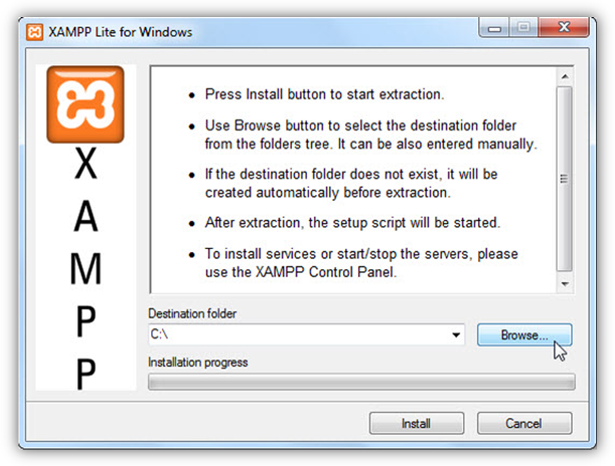

Lựa chọn ổ di động của bạn, hoặc 1 thư mục riêng biệt nào đó. Lưu ý rằng ổ USB nên còn trống ít nhất 250 Mb:

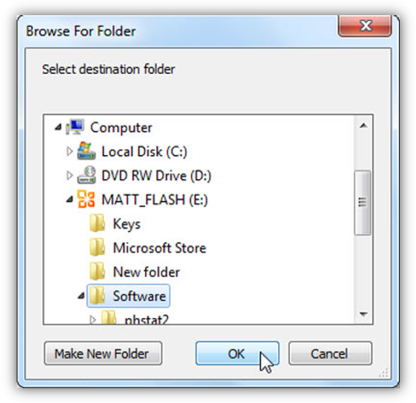

Nhấn Install để bắt đầu cài đặt, quá trình này có thể diễn ra nhanh hoặc lâu tùy thuộc vào tốc độ ghi – đọc của ổ USB:

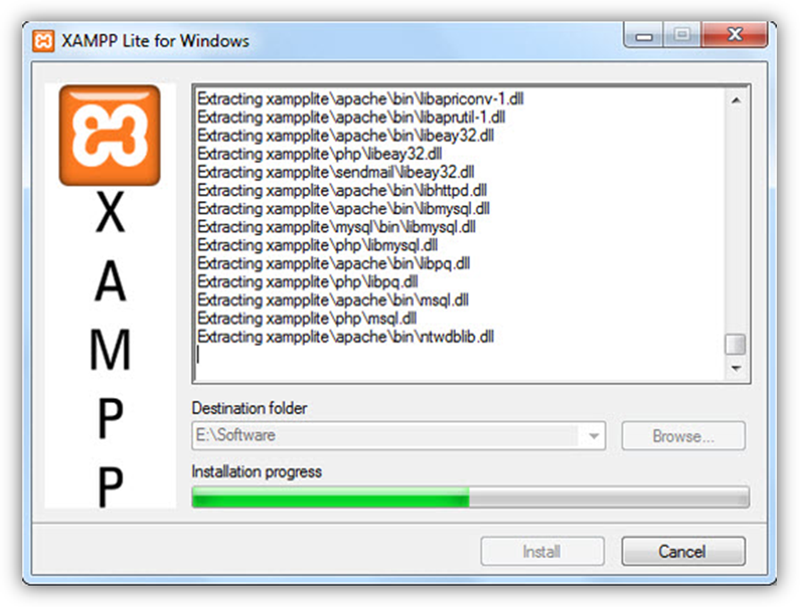

Quá trình trên kết thúc, 1 cửa sổ dòng lệnh xuất hiện để thông báo hoàn tất. Nếu bạn muốn tạo shortcut ở start menu và desktop thì gõ Y, còn nếu không thì N:

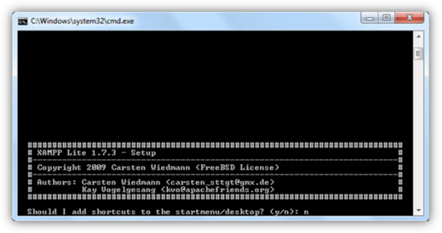

Bước tiếp theo, chọn Y để tùy chỉnh các thông số kỹ thuật:

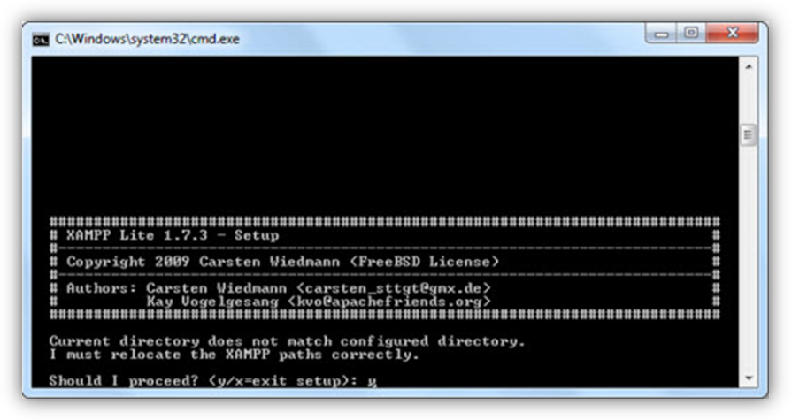

Đến bước tiếp này, chọn Y để hoàn tất quá trình biến XAMPP hoàn toàn thành portable. Chương trình được cấu hình và thiết lập hệ thống server hoạt động mà không cần xác định vị trí cố định, vì vậy server này sẽ hoạt động bất cứ, mọi lúc mọi nơi:

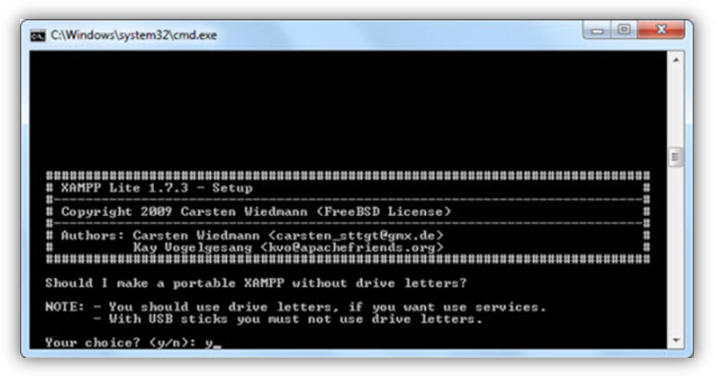

XAMPP sẽ hoàn tất các thay đổi lần cuối cùng, nhấn Enter:

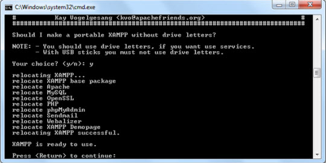

Sau đó, chương trình sẽ tự động kích hoạt giao diện dòng lệnh của XAMPP. Tại dòng đầu tiên, thiết lập múi giờ cho đúng với giờ hệ thống:

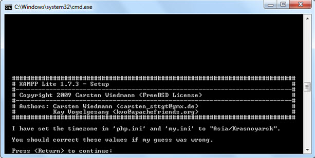

Tại bước tiếp theo, chọn 1 để khởi động XAMPP, hoặc các lựa chọn khác:

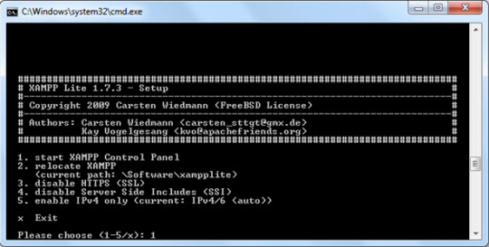

Sử dụng XAMPP portable

Rất đơn giản, chỉ cần mở thư mục lưu trữ và chạy file xampp-control.exe:

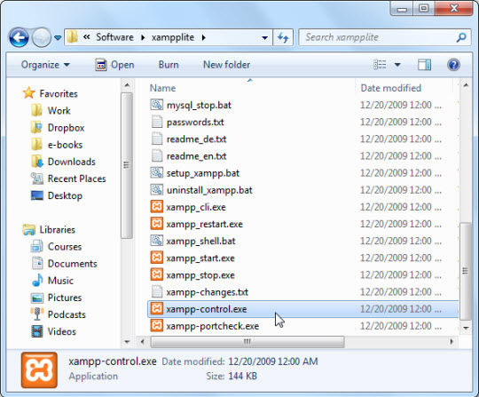

Tiếp tục nhấn Start ở mục Apache và MySQL để bắt đầu kích hoạt webserver:

Lưu ý: không tích vào ô Svc, điều này sẽ biến server thành 1 service bắt buộc của Windows. Nếu tích vào ô Svc, XAMPP sẽ không còn khả năng portable nữa

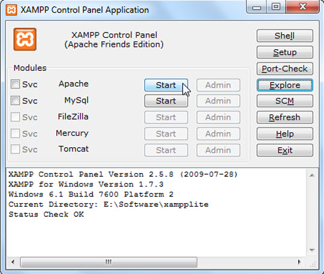

Đối với những hệ thống Windows có Firewall, sẽ thông báo có chặn hoạt động của server. Chọn Allow để webserver hoạt động:

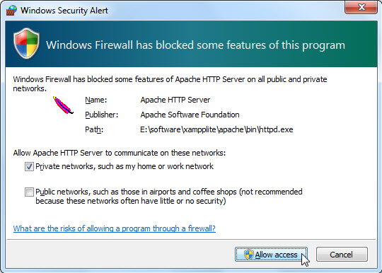

Sau đó, nhấn vào Admin để mở trang XAMPP admin từ trình duyệt của hệ thống, hoặc sử dụng địa chỉ [http://localhost/](http://localhost/), [http://127.0.0.1](http://127.0.0.1):

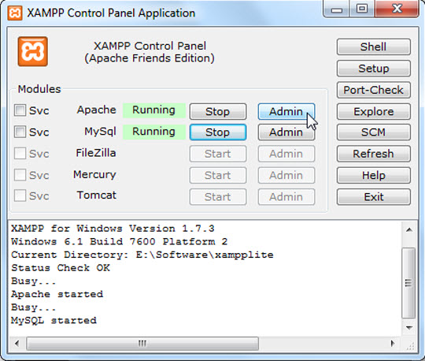

Nếu tất cả không có vấn đề gì, bạn sẽ nhìn thấy trang đầu tiên của XAMPP như sau:

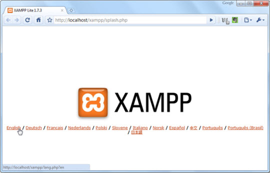

Chọn ngôn ngữ phù hợp, ở đây là English:

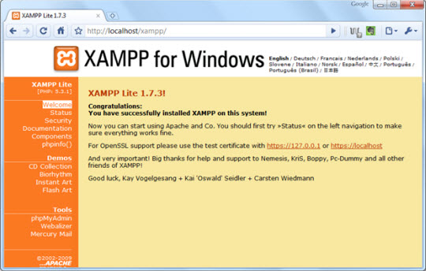

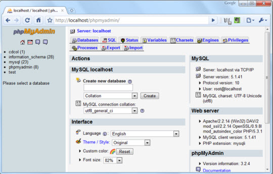

Bạn có thể lưu các trang web tùy chỉnh trên vào thư mục \xampplite\htdocs\\ để thuận lợi cho việc truy cập và làm việc sau này:

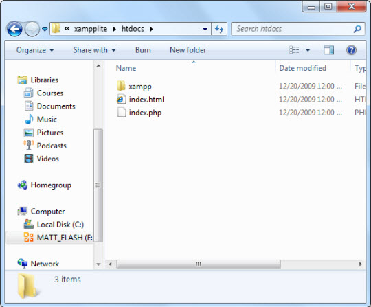

Nếu muốn ngừng hoạt động của server, chỉ cần nhấn nút Stop tương ứng các dịch vụ của XAMPP, nếu bấm nút Exit trên cùng bên phải, XAMPP sẽ thu gọn lại dưới thanh hệ thống chứ không tắt hẳn:

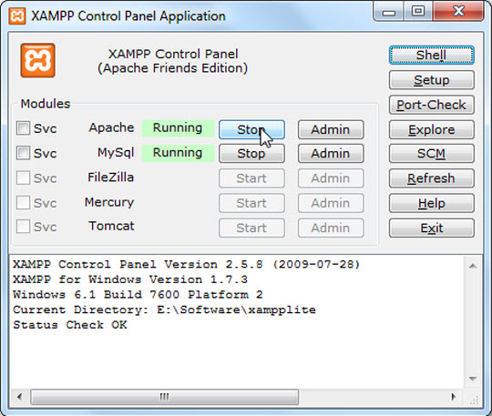

Hoặc bạn có thể sử dụng file xampp_stop.exe trong thư mục xampplite:

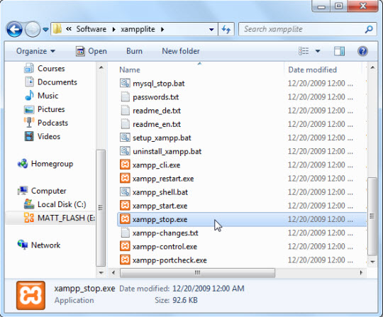

Để có thể sử dụng OpenID cần sửa file D:\xampp\php\php.ini

``` ini
;extension=php_curl.dll
```

Thay bằng

``` ini
extension=php_curl.dll
```

(thực chất là bỏ dấu `;` đi.)

Sau đó tiến hành khỏi động lại xampp

## Hướng dẫn sử dụng vhost trong xampp

Sửa file D:\xampp\apache\conf\httpd.conf Tìm đến dòng

``` text
# Virtual hosts
```

Thêm xuống dưới dòng sau

``` text
Include "conf/vhosts/*.conf"
```

Tạo thư mục D:\xampp\apache\conf\vhosts

Với mỗi domain ảo ví dụ domain nukeviet.net Tạo file D:\xampp\apache\conf\vhosts\nukeviet.net.conf với nội dung như sau

``` text
<VirtualHost 127.0.0.2:80>
    ServerName nukeviet.net
    ServerAlias www.nukeviet.net
    DocumentRoot D:/xampp/htdocs/nukeviet.net
</VirtualHost>
```

Trong đó 127.0.0.2 là IP, giá trị này khác nhau đối với mỗi domain Thư mục D:/xampp/htdocs/nukeviet.net là nơi để mã nguồn. Thêm dòng sau vào cuối file C:\Windows\System32\Drivers\etc\hosts

``` text
127.0.0.2   nukeviet.net
```

Khổi động lại apache

Lưu ý:

- Tên miền ảo không sử dụng phần mở rộng dev bởi trình duyệt sẽ yêu cầu bắt buộc https, tham khảo thêm: [https://ma.ttias.be/chrome-force-dev-domains-https-via-preloaded-hsts/](https://ma.ttias.be/chrome-force-dev-domains-https-via-preloaded-hsts/)
- Xampp mặc định sau khi cài sẽ sử dụng Username là **root** và mật khẩu để trống (rỗng). Đây là Username và mật khẩu sử dụng để truy cập vào cơ sở dữ liệu MySQL (khai báo khi cài đặt Nukeviet).
- Mỗi khi thay đổi thông số cấu hình (thủ công) bạn cần dừng Xampp để có thể ghi file cấu hình và khởi động lại phần mềm để nạp lại các thông số mới sau khi thay đổi xong.
- Nếu port 80 bị chiếm, Cần kiểm tra lại xem ứng dụng nào chiếm, thường là Skype, hoặc world wide web publishing service
- Với Skype thì tắt Skye đi, sau apache chạy xong mới bật skype lại, hoặc tắt chế độ sử dụng cổng 80 của skype đi
- Với world wide web publishing service

B1: Run\>Services.msc để mở services trên windows

B2. Tìm đến world wide web publishing service. click chuột phải \> chọn stop. hoặc click đôi và chọn stop.

B3. Khởi động lại apache thành công 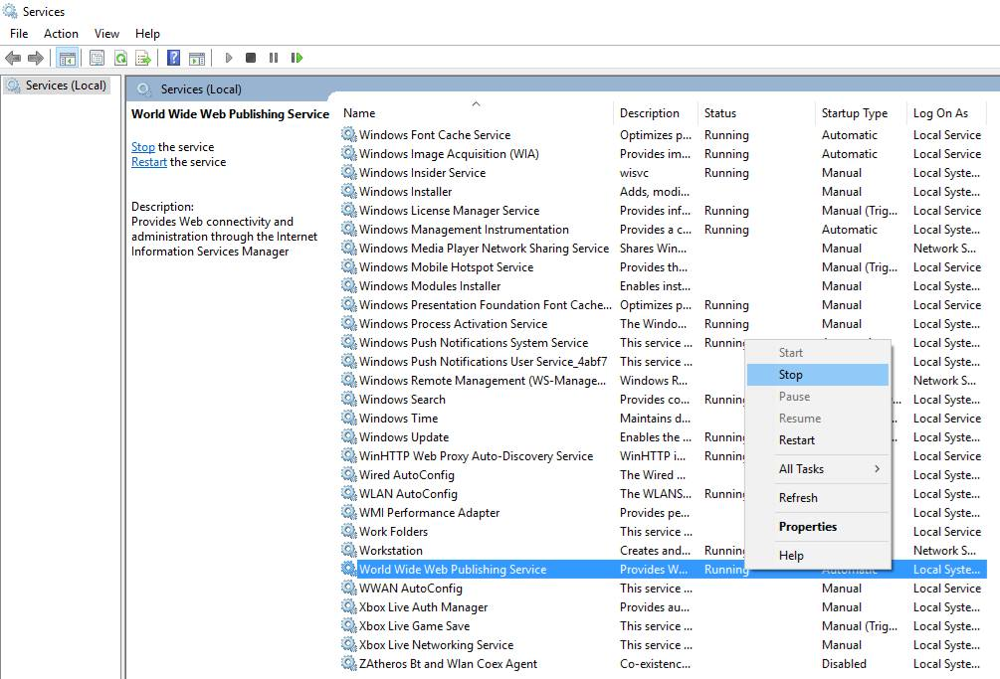

Tham khảo: [https://www.facebook.com/groups/nukeviet/permalink/1515482491827179/](https://www.facebook.com/groups/nukeviet/permalink/1515482491827179/)
